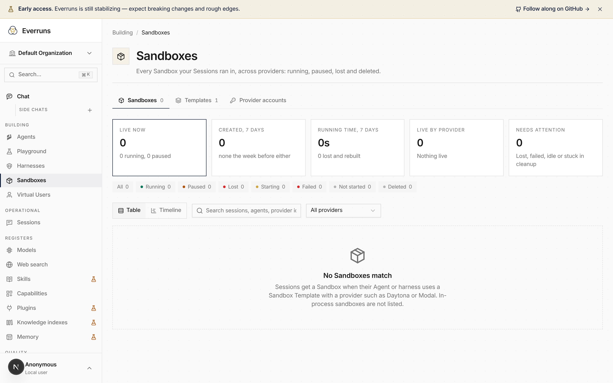

**Sandboxes** is now one page organized like **Models**: a **Sandboxes** tab with the fleet
table and timeline, a **Templates** tab for [Sandbox Templates](/features/sandbox-templates/), and a **Provider accounts** tab for admins. The
sidebar has a single Sandboxes entry under Building instead of a collapsed group of three.

Tabs on the Models, Web search and Sandboxes pages are now real paths, such as
`/models/providers`, `/web-search/defaults` and `/sandboxes/templates`, so a tab can be
bookmarked, shared or opened in a new browser tab. Old links keep working: `?tab=` links,
`/sandbox-templates` and `/sandbox-provider-accounts` redirect to the new paths.

[#4653](https://github.com/everruns/everruns/pull/4653)
