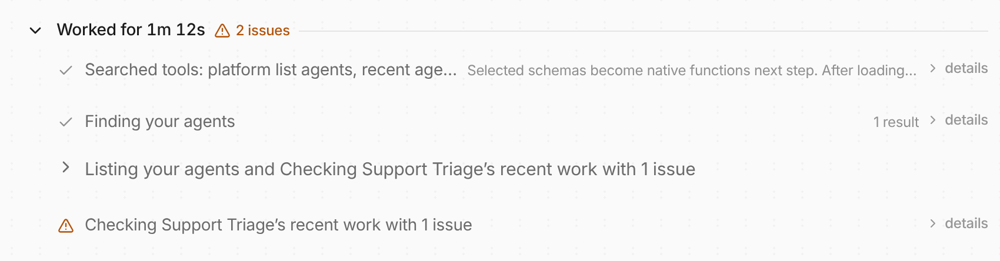

**In the UI:** when a tool call fails and the agent keeps going, the chat work
log shows an amber "1 issue" marker instead of a red "1 error", and the failed
tool rows use warning styling. Red stays for work that stopped, such as a failed
turn.

**In code:** a failed `tool.completed` event carries `"severity": "issue"`, and
`turn.completed` carries `issue_count` with the number of failed tool calls the
turn absorbed. A failed turn is still reported as `turn.failed`. The act
headline now reads "with 1 issue". The OpenAPI spec and the [event reference](/event-reference/)
document both fields; see [Events](/features/events/) for how clients read them.
