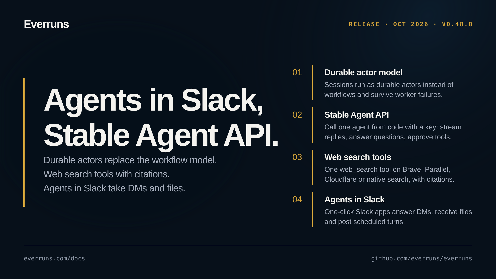

## Highlights

- **Durable actor model replaces the workflow model**: Each session runs as a durable actor: a worker leases the session and runs the whole turn from its journal instead of per-step durable workflows, so turns survive worker and control-plane failures and a cancel ends only its own turn ([changelog](/changelog/2026-10-12-sessions-run-as-actors/), [#4608](https://github.com/everruns/everruns/pull/4608), [#4629](https://github.com/everruns/everruns/pull/4629), [#4642](https://github.com/everruns/everruns/pull/4642), [#4663](https://github.com/everruns/everruns/pull/4663)).
- **Stable Agent API**: Call one agent from code with an Agent API key: create sessions, stream replies, answer its questions and approve its tools, with end users, browser origins and per-caller daily spending limits ([changelog](/changelog/2026-10-11-agent-api-channel/), [#4490](https://github.com/everruns/everruns/pull/4490), [#4508](https://github.com/everruns/everruns/pull/4508), [#4511](https://github.com/everruns/everruns/pull/4511), [#4514](https://github.com/everruns/everruns/pull/4514), [#4516](https://github.com/everruns/everruns/pull/4516), [#4527](https://github.com/everruns/everruns/pull/4527)).
- **Web search tools**: One `web_search` tool backed by free search, Brave, Parallel, Cloudflare Web Search or the model provider's native search, with organization search accounts and defaults and sentence-level citations ([changelog](/changelog/2026-10-12-one-web-search-tool/), [#4551](https://github.com/everruns/everruns/pull/4551), [#4605](https://github.com/everruns/everruns/pull/4605), [#4611](https://github.com/everruns/everruns/pull/4611), [#4614](https://github.com/everruns/everruns/pull/4614), [#4621](https://github.com/everruns/everruns/pull/4621), [#4625](https://github.com/everruns/everruns/pull/4625), [#4635](https://github.com/everruns/everruns/pull/4635), [#4643](https://github.com/everruns/everruns/pull/4643)).
- **Agents in Slack**: One-click Slack apps take direct messages and answer them in the DM, store files sent with a message in the session, post scheduled turns to the conversation and use the agent's avatar as the app icon ([changelog](/changelog/2026-10-13-slack-agents-dms-and-files/), [#4545](https://github.com/everruns/everruns/pull/4545), [#4597](https://github.com/everruns/everruns/pull/4597), [#4603](https://github.com/everruns/everruns/pull/4603), [#4641](https://github.com/everruns/everruns/pull/4641), [#4677](https://github.com/everruns/everruns/pull/4677)).

## Upgrade notes

- `api_endpoint` channels convert to Agent API channels at startup with the same keys. Old request shapes return `400 api_endpoint_retired` and `/v1/apps/{app}/api/{channel}` routes return `410`; move clients to `/v1/channels/{channel_id}` ([#4527](https://github.com/everruns/everruns/pull/4527)).
- Agents must give a reason for every change by default; an organization can turn the **Require reasons from agents** flag off to let such changes through with a warning ([#4552](https://github.com/everruns/everruns/pull/4552)).

## In the changelog

- [Agent budgets stop turns before each model call](/changelog/2026-10-10-agent-budgets-enforced/)
- [Agents must give a reason for every change by default](/changelog/2026-10-10-agent-change-reasons-required/)
- [api_endpoint channels convert to Agent API channels](/changelog/2026-10-10-api-endpoint-channels-converted/)
- [Rate agent replies and branch a chat from any message](/changelog/2026-10-10-chat-feedback-and-branching/)
- [ChatGPT plan connections no longer need a feature flag](/changelog/2026-10-10-chatgpt-plan-no-flag/)
- [Everruns CLI help shows a worked example for every command](/changelog/2026-10-10-cli-worked-examples/)
- [Outbound network policy modes, audit log and org allowlists](/changelog/2026-10-10-egress-policy-controls/)
- [Explicit communication lets agents choose when to reply](/changelog/2026-10-10-explicit-communication/)
- [GitHub triggers wake agents on CI results](/changelog/2026-10-10-github-ci-triggers/)
- [Pick and configure guardrail checks in the agent editor](/changelog/2026-10-10-guardrail-checks-editor/)
- [Built-in harnesses reorganized as a tree by use case](/changelog/2026-10-10-harness-tree/)
- [Label MCP tools as read only or changes things](/changelog/2026-10-10-mcp-tool-risk-labels/)
- [Add your own MCP servers and use them in chat](/changelog/2026-10-10-my-mcp-servers/)
- [Everruns agents act as Poppy personal agents](/changelog/2026-10-10-poppy-personal-agents/)
- [serve keeps daemon data in S3 and can require API keys](/changelog/2026-10-10-serve-bucket-store-and-auth/)
- [Session SQL databases survive server restarts](/changelog/2026-10-10-session-sql-databases-persist/)
- [Session Trace view replaces Transcript and Timeline](/changelog/2026-10-10-session-trace-view/)
- [Tools in Shell runs an agent's tools from Bashkit scripts](/changelog/2026-10-10-tools-in-shell/)
- [Call one agent from code with an Agent API key](/changelog/2026-10-11-agent-api-channel/)
- [Load Everruns workflow skills through MCP](/changelog/2026-10-11-mcp-workflow-skills/)
- [Set an agent's avatar from the CLI and MCP](/changelog/2026-10-12-agent-avatar-cli-mcp/)
- [Choose where an agent's GitHub App lives, and manage it from the CLI](/changelog/2026-10-12-agent-github-org-cli/)
- [An agent's GitHub App gets its own section, name and avatar step](/changelog/2026-10-12-agent-github-section/)
- [Agents can cap output tokens per response](/changelog/2026-10-12-agent-max-output-tokens/)
- [Agents can sync provider models with the Platform capability](/changelog/2026-10-12-agents-sync-provider-models/)
- [API keys a Bashkit agent uses but never sees](/changelog/2026-10-12-api-keys-agent-never-sees/)
- [Browser agents see their screenshots and keep their page](/changelog/2026-10-12-browser-agents-screenshots-focus/)
- [Cloudflare Web Search joins as a Web Search provider](/changelog/2026-10-12-cloudflare-web-search/)
- [Docs moved to everruns.com/docs](/changelog/2026-10-12-docs-move-to-everruns-com/)
- [Check out private pull requests into the managed sandbox](/changelog/2026-10-12-github-checkout-pull-request/)
- [GitHub tools act as one chosen identity, with narrowed tokens](/changelog/2026-10-12-github-tools-act-as/)
- [GitHub triggers narrow CI events by branch and workflow](/changelog/2026-10-12-github-trigger-ci-filters/)
- [Model card links on the Models page](/changelog/2026-10-12-model-card-links/)
- [Muse Wonder, Meta's new top model, is available in Everruns](/changelog/2026-10-12-muse-wonder/)
- [Web search: one tool, search providers and organization defaults](/changelog/2026-10-12-one-web-search-tool/)
- [Parallel joins Brave as a Web Search provider](/changelog/2026-10-12-parallel-web-search/)
- [Prompt caching gets a retention setting and a prompt-only mode](/changelog/2026-10-12-prompt-cache-retention/)
- [Prompt caching on Bedrock, OpenRouter Claude and Mistral](/changelog/2026-10-12-prompt-caching-bedrock-openrouter-mistral/)
- [Sessions recover from provider limits and follow the agent's model](/changelog/2026-10-12-provider-limit-recovery/)
- [Create read-only personal access tokens](/changelog/2026-10-12-read-only-personal-access-tokens/)
- [Sandbox file tools all read the managed Sandbox workspace](/changelog/2026-10-12-sandbox-file-tools-one-workspace/)
- [Sandboxes page with tabs, and tab links you can share](/changelog/2026-10-12-sandboxes-tabs/)
- [Agents now see why a session schedule cron was rejected](/changelog/2026-10-12-schedule-cron-errors-reach-agent/)
- [Scheduled turns in a Slack conversation post to it](/changelog/2026-10-12-scheduled-turns-post-to-slack/)
- [Session Trace names prompt cache resets and their cause](/changelog/2026-10-12-session-trace-cache-resets/)
- [Agent sessions now run as actors instead of workflows](/changelog/2026-10-12-sessions-run-as-actors/)
- [Tool reveals keep the prompt cache on current Claude and GPT-6 models](/changelog/2026-10-12-tool-changes-keep-prompt-cache/)
- [Recovered tool failures show as issues, not red errors](/changelog/2026-10-12-tool-failures-shown-as-issues/)
- [Web search answers cite their sources, sentence by sentence](/changelog/2026-10-12-web-search-citations/)
- [Slack agents answer DMs and keep the files people send](/changelog/2026-10-13-slack-agents-dms-and-files/)
- [Web search no longer fails on some result snippets](/changelog/2026-10-13-web-search-snippet-crash/)

See the [GitHub release](https://github.com/everruns/everruns/releases/tag/v0.48.0) and the [full release notes](https://github.com/everruns/everruns/blob/main/CHANGELOG.md#0480---2026-10-13) for every pull request in this version.
