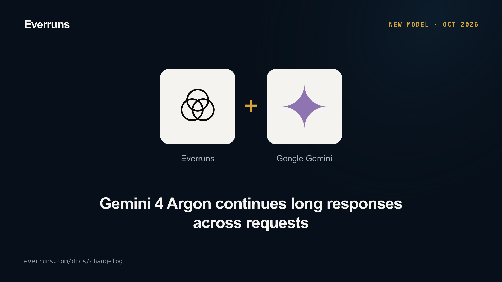

Everruns now supports long decode on Gemini 4 Argon. Raise the output budget
above 65,536 tokens to let one model response continue across multiple requests.
The default stays at 65,536; input, thinking, and output share the unified
1,048,576-token context window.

In an agent package:

```toml
schema_version = 1
name = "deep-reasoning"
instructions = "Work through the problem carefully."
max_output_tokens = 100000

[model]
provider = "gemini"
model = "gemini-4-argon"
```

Text and reasoning stream as one response. Usage combines every completed hop,
including thinking and repeated input. Invalid continuation tokens or a failed
hop fail the call. Cancellation stops local continuation requests.

Argon also gains its built-in model profile and low, medium, and high thinking
levels. See [Google Gemini](/providers/gemini/) for configuration, host timeouts,
and recovery limits.

## Update 2026-10-14

Argon is also an enabled favourite and the preferred default for new Gemini
setups. Read the [defaults and favourites update](/changelog/2026-10-14-gemini-argon-default/).

## Update 2026-10-19

Grounded responses now preserve citations and search usage across continuation
hops. Read the [grounding fix](/changelog/2026-10-19-gemini-continuation-grounding/).
