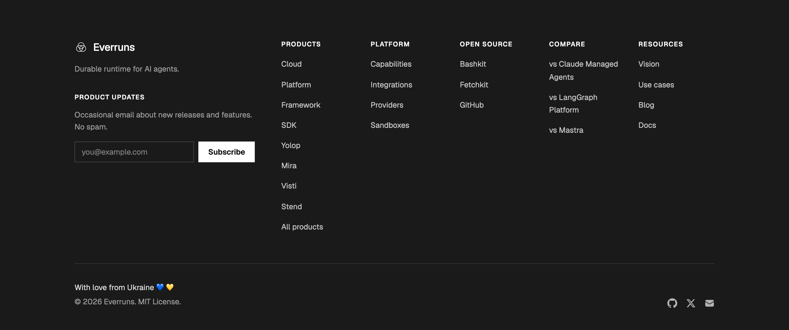

The Everruns landing site and [documentation](/getting-started/introduction/) now include
[Visti](https://visti.sh) and [Stend](https://stend.sh) in the **Products**
column of the footer. Scroll to the bottom of any page and select either
product to open its site in a new tab. The same product links appear on both
sites through their shared footer.

