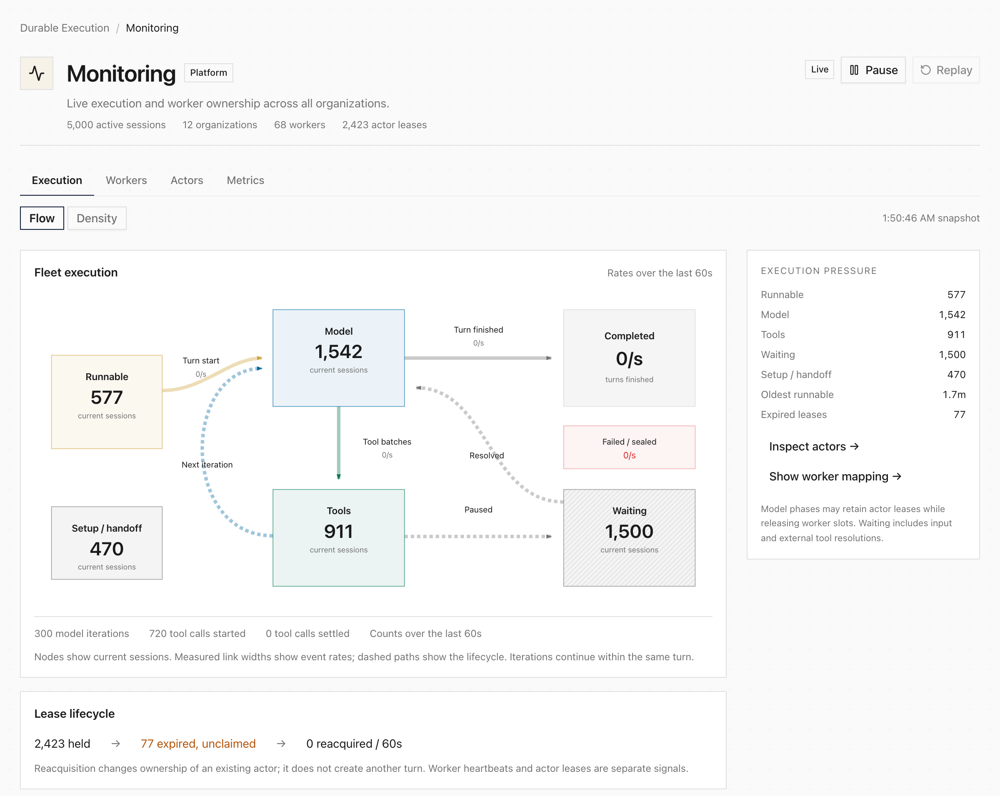
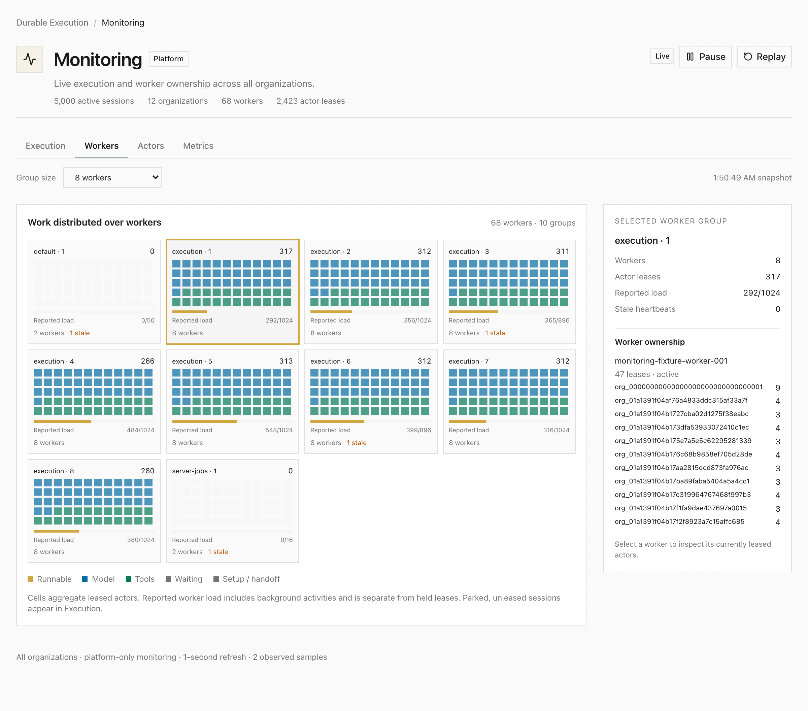

**Monitoring** shows the execution fleet moving through runnable work, model
iterations, tools, and waiting. Flow is the default; Density shows changes over
time. Snapshots refresh every second, with pause and replay of observed history.

The Workers tab maps organizations to worker ownership. Inspect an actor's lease
expiry, last renewal, fence, cursors, and ownership history; Metrics provides the
conventional counters alongside these views.

Organization admins opt in through **Settings → Features → Monitoring**. Their
view stays within that org; cross-org monitoring requires platform access.
See the [Monitoring guide](/observability/monitoring/).
