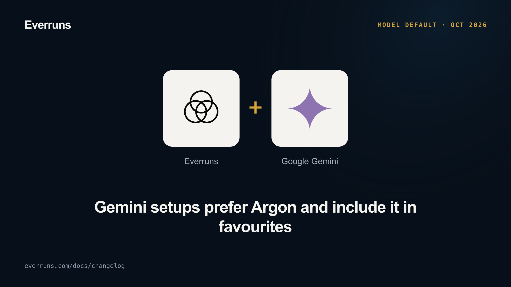

**In the UI:** Gemini 4 Argon now appears as an enabled favourite in the
server's built-in Google Gemini model catalogue. Its model profile supplies context limits,
pricing, and reasoning controls in the model picker.

**In the API:** the favourites list includes Argon:

```http
GET /v1/models?favorites_only=true
```

When a new Gemini setup needs an organisation default, it prefers Argon over
other Gemini models. An existing working default stays selected, and other
providers retain their selection policy. See [Google Gemini](/providers/gemini/)
for configuration and long decode support.
