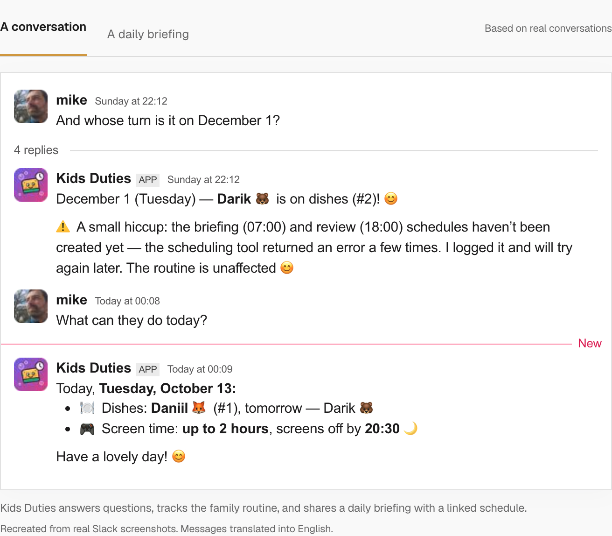

[Build Agents for Slack](/integrations/slack/) now opens an integration overview
with a real Kids Duties walkthrough, English recreations of its Slack
conversation and daily briefing, and steps for building and publishing an Agent.
The page previously redirected to the capability reference.

Use **Build a Slack Agent** to reach the building steps, switch between the two
conversation examples, or follow **Publish an existing Agent** to the installation
guide. The detailed Slack reference remains available for scopes, session routing,
actions and troubleshooting. Slack navigation now uses the recognizable Slack mark.

