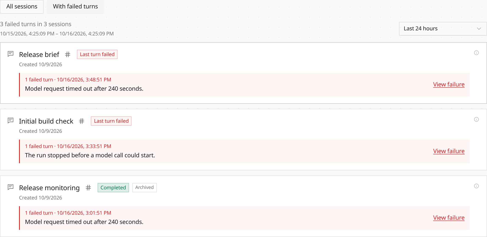

Click **1 failed** on the Agents list to see sessions with failed turns during
the chart's 24-hour window. Hover or keyboard-focus the chart to see its window
and hourly scale.

The filtered Sessions tab includes older sessions and sessions that later
recovered, with separate counts for failed turns and affected sessions. Each
card shows the latest matching error and a **View failure** link to its exact
turn in Trace. Session badges distinguish a failed last turn, completion and
cancellation, while a running turn keeps its live status.

See [Investigate failed turns](/observability/#investigate-failed-turns).
