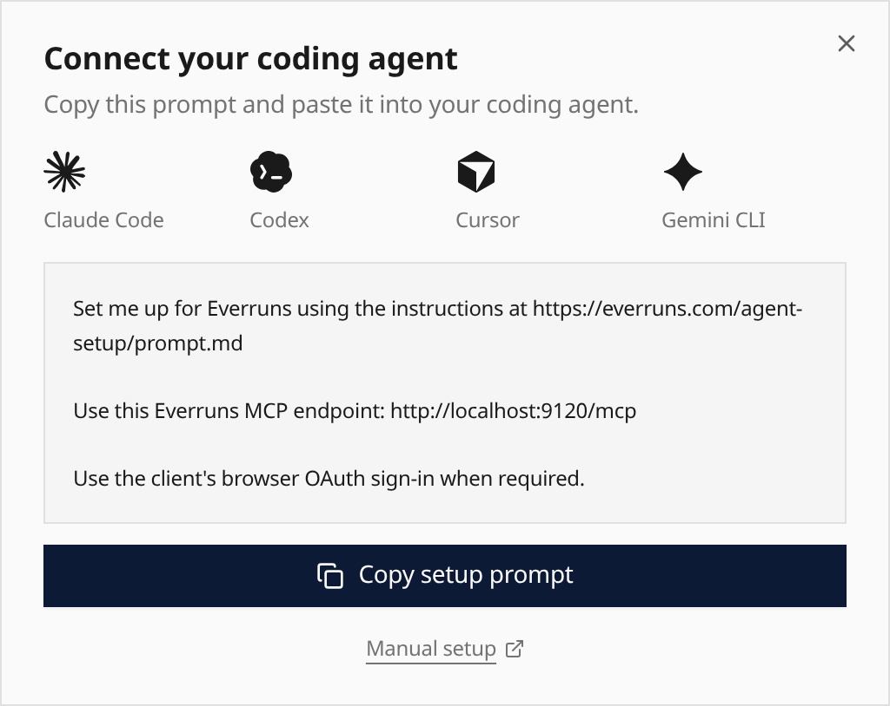

Choose **Connect your coding agent** from the user menu, the Agents first-use
state or after organisation setup. Copy the prompt into Claude Code, Codex,
Cursor or Gemini CLI to follow the maintained setup instructions. Agent icons
identify compatible tools; everyone uses the same prompt.

The prompt preserves your deployment's MCP endpoint and authentication mode.
Your agent follows its live documentation and discovery metadata, then guides
you through browser sign-in when needed. Model-provider setup stays in the
existing onboarding flow, with **Add a model provider** available after a skip.

See [Use in AI Tools](/getting-started/use-in-ai-tools/) for manual installation
and managing connected clients.
