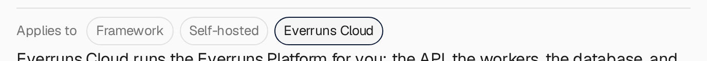

The **Applies to** row under documentation titles now shows unavailable targets
with gray labels and borders, without crossing out their names. Applicable
targets keep their existing emphasis, and all three labels still link to their
respective getting-started pages.

See the [introduction](/getting-started/introduction/) for the differences between
Framework, Self-hosted, and Everruns Cloud.

