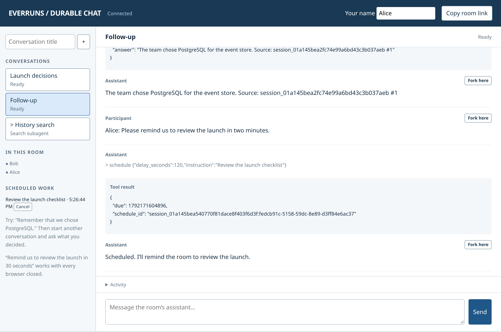

The standalone Cloudflare chat example runs directly inside a native
Cloudflare Durable Object. A room contains independent conversations and forks, keeps
reconnect receipts beside queued messages, and wakes for scheduled follow-ups
even when every browser is closed. A history-search child resumes from its own
last committed engine step after a restart.

From `examples/cloudflare-durable-chat`, after installing the build prerequisites:

```sh
npm ci
npm run build
cp .dev.vars.example .dev.vars
npm run dev
```

Add your OpenRouter key to `.dev.vars`, use Muse Spark 1.3 Contributor, and share the room
link with another browser. See the [durable chat walkthrough](/framework/examples/durable-chat/)
for the storage and recovery boundaries. This advanced host example offers an optional shared
access key; it has no automatic compaction.
