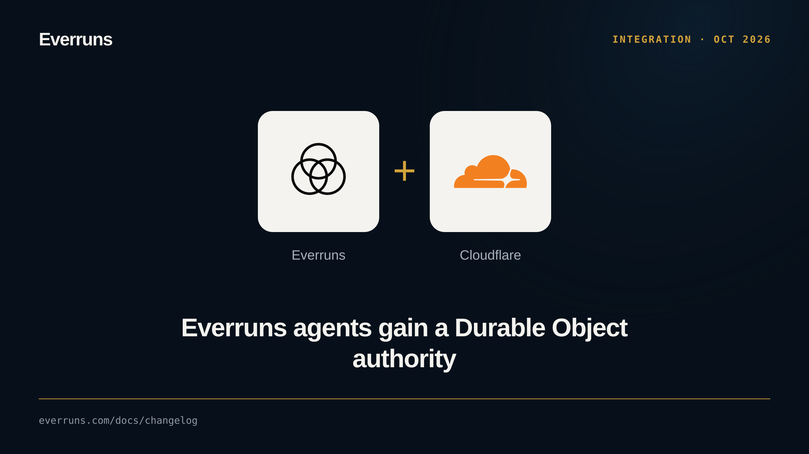

An experimental, source-only adapter now runs ordinary Rust agents with a Durable
Object owning durable admission, session events, execution leases and alarms.
Native executors and Wasm isolates share the platform worker’s recovery driver,
so tools and agent logic stay in Rust.

```sh
cargo run -p everruns-durable-object --example native
```

Configure the Worker and service secrets first, as described in
[Durable Object authority](/framework/durable-objects/). Framework agents and
registered serve agents can supply the execution host. Recovery tests kill the
native executor after a tool effect and verify completion without resending input. A Wasm application uses the ordinary Rust host and capability
interfaces inside the object. Qualification tests cover Cloudflare isolate loss and replicated celld owner loss.
Validate your production storage and deployment limits before adopting this
experimental profile. It does not change the guarantees of
ordinary Framework sends or the existing celld snapshot example.
