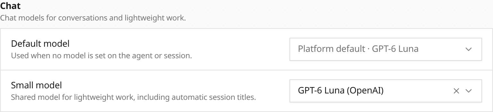
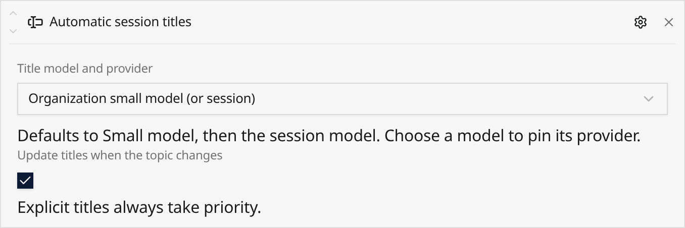

**In the UI:** Enable **Automatic session titles** on a harness, agent, or
session. Under **Models → Defaults**, choose a shared **Small model** for
lightweight work. Capability settings can inherit that default, use the session
model, or pin a model and provider.





**In code:** Attach the capability without enabling title tools:

```json
{
  "ref": "automatic_session_titles",
  "config": {
    "retitle": true
  }
}
```

[Automatic session titles](/capabilities/automatic-session-titles/) run outside
the answer path. Sparse checks combine keep-or-rename decisions in one request,
with a cooldown and increasing message intervals. Explicit titles always win,
including renames made while generation is running. The [organization small-model
default](/providers/#organization-small-model-default) is independent of the main
chat and Decisions models.
