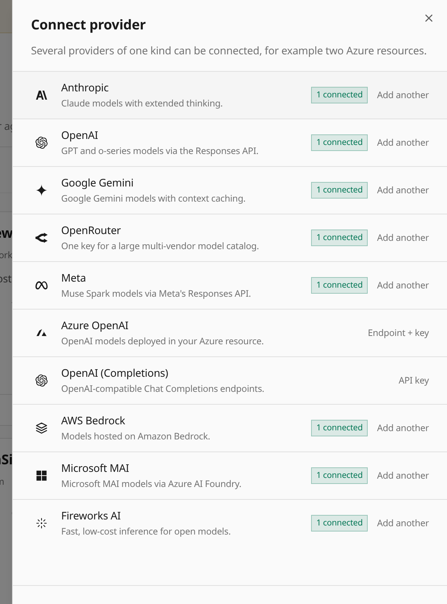

ChatGPT Plan no longer appears in the Platform provider setup, provider pages,
model lists, or chat controls. Its open-source sign-in flow requires a browser
callback on `127.0.0.1`, which cannot reach a remote Everruns server. Existing
connections remain stored, and the framework driver remains available to custom hosts.
See the [ChatGPT Plan framework guide](/features/chatgpt/) for supported usage.
