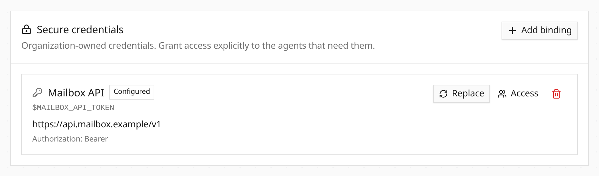

Credentials can now belong to a virtual user, agent, session or organization. Open **Credentials** on an agent or session, or manage personal and organization credentials in Settings. Organization credentials require an explicit access grant. Values stay write-only; revoke a binding or grant to stop its next participating request.

[Web Fetch](/capabilities/web-fetch/) can capture several JSON response fields directly into encrypted storage. Persistent capture asks for approval of the exact request, destination and acting identity. Subsequent Web Fetch and Bashkit HTTP calls use references such as `$MAIL_TOKEN`; injected values and recognized response echoes are removed before tool results reach the agent.

The same ownership and access rules apply to [MCP parameter credentials](/integrations/mcp-credentials/). Existing GitHub connections retain their installation selection and repository limits.

**API change:** credential value updates now require the observed `revision` to prevent stale writes.
