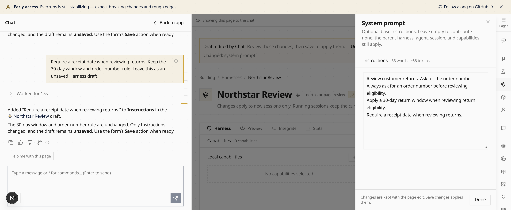

Enable **Chat mode** in **Settings > Features**. Open an Agent and press
**Command-J** or **Ctrl-J**. Ask “Make this agent’s instructions suitable for children.”
Chat reads your unsaved form and stages a draft with **Undo**. Review it, then use
**Save changes** or **Discard**. Version checks protect concurrent edits.
Back to app preserves the conversation and draft. Saved Agent changes support
revision-checked **Undo all**; see [Platform Chat](/built-ins/harnesses/platform-chat/).

<video src="./walkthrough.mp4" poster="./workspace-poster@2x.png" controls playsinline></video>

Fictional demo data; synthetic narration; waiting periods shortened.

## Update 2026-10-24

Page context follows every app page, including filters and loaded records.
Chat stages supported fields in Harnesses, Virtual Users, Observers, Knowledge
and other forms. Use each form’s existing Save or Create action. Credentials
and immediate actions keep their normal controls. Hover navigation icons for
explanations, or open **Pages** for a labeled menu.

## Update 2026-10-26

Chat now stages [settings and secondary forms](/changelog/2026-10-26-chat-page-settings/) and shares operational status.
