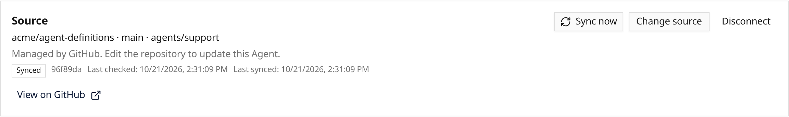

Agents can now follow a package in a GitHub repository continuously. Open an
Agent, select **Source → Sync from GitHub**, choose the repository, branch and
package path, then review changes before enabling sync. For example, point at
`agents/support/` containing:

```toml
schema_version = 1
name = "support"
instructions_file = "instructions.md"
```



Pushes and periodic checks apply valid updates automatically. The Source panel
shows the applied commit and sync errors. Invalid updates retain the last working
definition. Synced fields are read-only across Everruns; edit the repository or
disconnect to restore local editing. See
[Define agents as files](/how-to/define-agents-as-files/#sync-an-agent-continuously-from-github).
