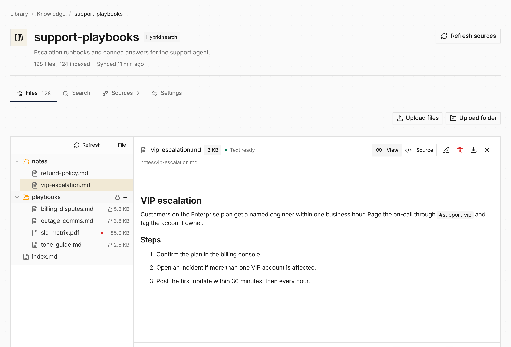

[Knowledge](/capabilities/knowledge/) replaces the two undeployed Knowledge Base and Knowledge Index surfaces. Create a file collection, add notes or uploads, or connect GitHub through an existing connection. Public HTTPS Git sources also work. Indexing can stay off while agents browse read-only mounts and use exact grep.



Original binaries and file hierarchy are retained. Markkit extracts HTML, DOCX and spreadsheets; unsupported formats remain downloadable. Enable keyword or hybrid search when needed, and use the same retrieval service through an agent tool or Bashkit:

```bash
knowledge search --limit 5 'refund policy'
```

Collections preserve frontmatter and annotations, update indexes incrementally, and return immutable citations. Organization search accounts use encrypted service credentials. Knowledge is available as an Adoption feature: disabled by default, with organization owner/admin or platform operator opt-in on development and hosted deployments. Shared workspaces keep Knowledge attachments session-scoped; unsupported binary formats retain their originals.

Hosted deployments can persist Knowledge in S3 without moving existing inline
workspace files or image bytes.
