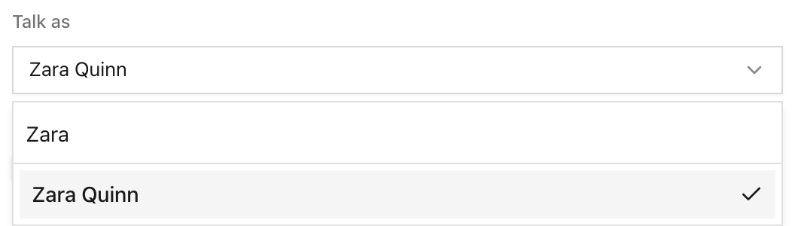

Search **Talk as** by user name in [Playground setup](/features/ui/#agents), including users beyond the first page. The Agent/harness picker also supports search. The selected user stays visible while searching, archived users remain unavailable, and only owners and admins can choose another end user.

On an Agent page, connect a [GitHub source](/how-to/define-agents-as-files/#sync-an-agent-continuously-from-github) from **More actions → Sync from GitHub**. Unconnected Agents no longer show an empty Source card. **Dry run** and **Test in Playground** keep their distinct setup routes: simulated actions or normal execution. Neither starts a chat immediately.

## Update 2026-10-24

Agent pages now have one **Test in Playground** action. Use the existing **Dry run** checkbox in Playground setup to simulate actions.
