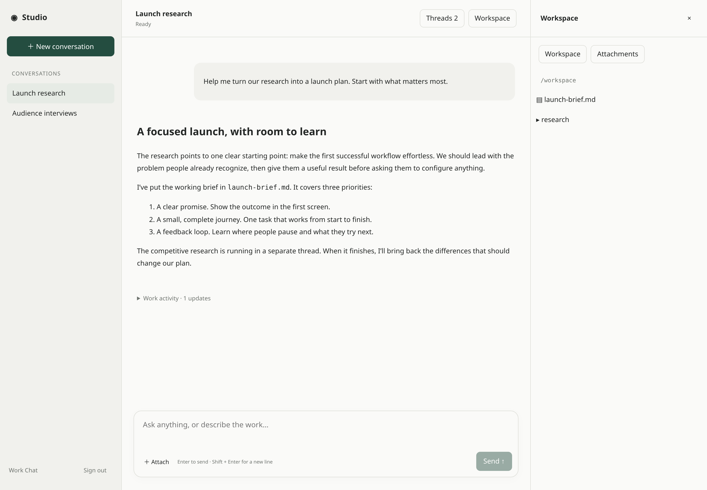
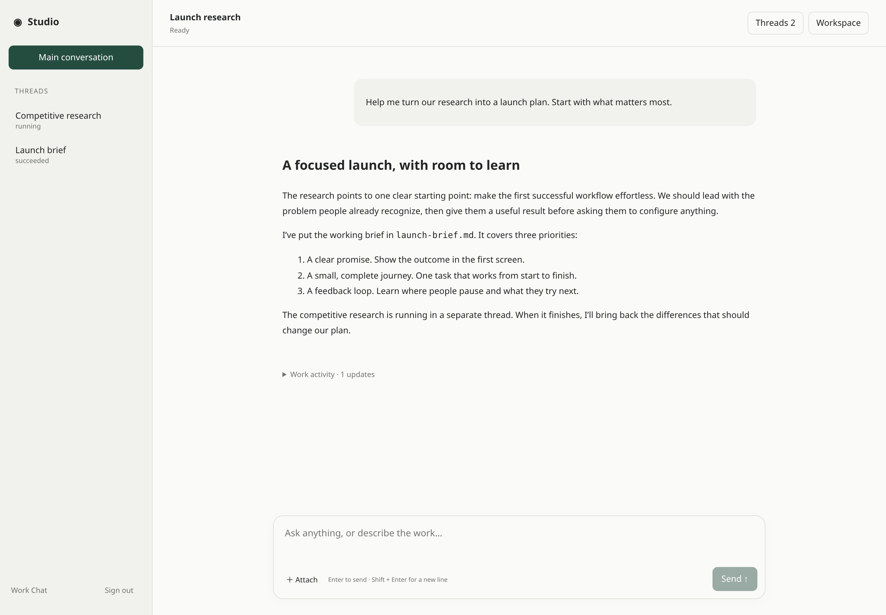

**Work Chat** is an Agent-owned channel with its own consumer sign-in and a
standalone browser app. Publish several channels for the same Agent, each at
its own stable hostname on your deployment's content domain.

Choose multiple conversations or one permanent main conversation with work
threads. Single mode requires effective coordinator tools; incompatible
publication or later capability changes are rejected. The interface streams
replies, follows work and exposes permitted questions, approvals and workspace
files. Existing ownership, budgets and read-only protections apply.





```json
{
  "channel_type": "work_chat",
  "channel_config": {
    "interface_mode": "multi_chat"
  }
}
```

See [Work Chat](/features/channels/#work-chat) for configuration and separate
browser-host deployment. Hosting requires DNS, TLS and a registered OIDC broker.
