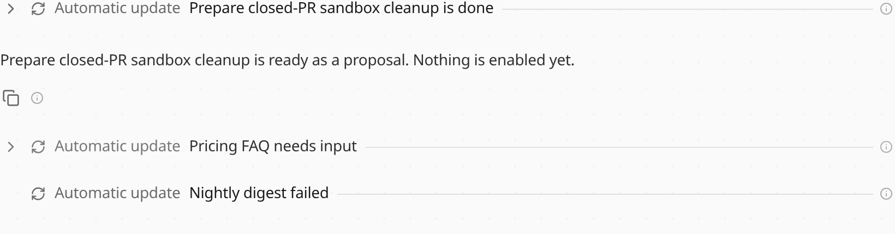

Chat shows a thread's report as one folded line, such as "Releases is done",
instead of a message filled with the report. Open the line to read it. A
finish with nothing to add is the line only. The coordinator still receives
the full text and answers in the conversation with what matters.

The Threads panel still lists what is working, what needs you, and what is
ready for review. See [Chat and threads](/features/ui/#chat-and-threads) and
[Coordination](/framework/coordination/).
