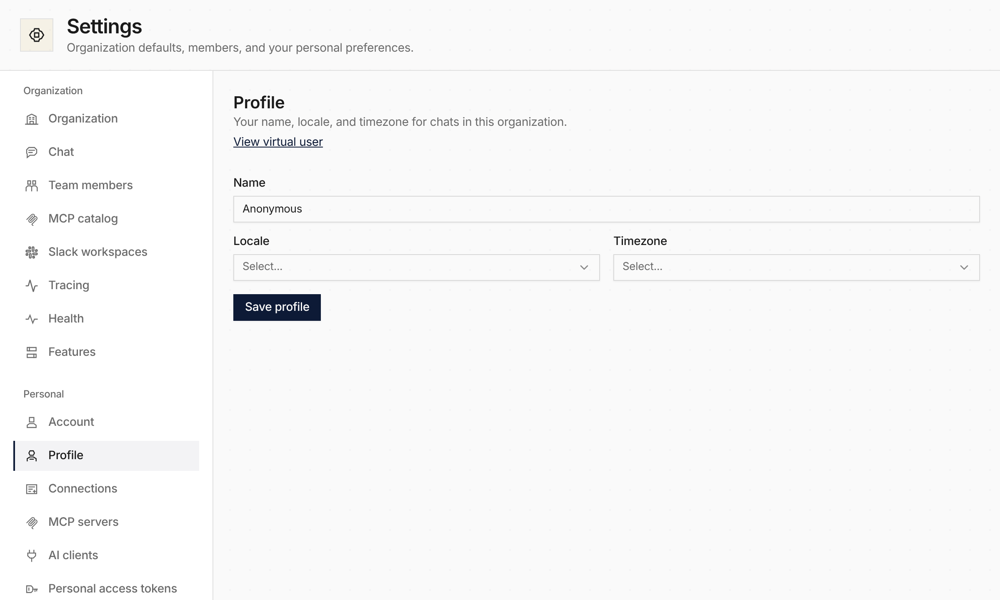

**In the UI:** personal settings under [Settings](/features/ui/#virtual-users-and-personal-settings) are separate pages. **Profile** is your name, locale, and timezone in this organization. **Connections** is provider sign-ins and credentials. **MCP servers** is the servers you add for yourself. **AI clients** is the apps you approved to use Everruns as you. Account and personal access tokens are unchanged.

`/settings/connections` opens Connections. Sign-in returns there.
