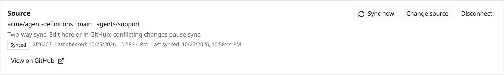

Agents connected to GitHub can now accept edits in Everruns too. Open **Change
source**, choose **Sync with GitHub**, preview the package and enable continuous
sync. Saved edits are queued and committed to the selected branch. Existing
bindings remain read-only until you opt in.

Two-way sync requires Contents write permission on the GitHub App and installation.
Branch protection still applies. If both sides change the package, sync pauses
and retains your local edits. Review the GitHub version before replacing them,
or disconnect to keep local editing.

Write-back preserves instruction and asset paths while manifest edits may normalize
formatting. Credentials and publication stay local. See
[Define agents as files](/how-to/define-agents-as-files/#sync-an-agent-continuously-from-github).
