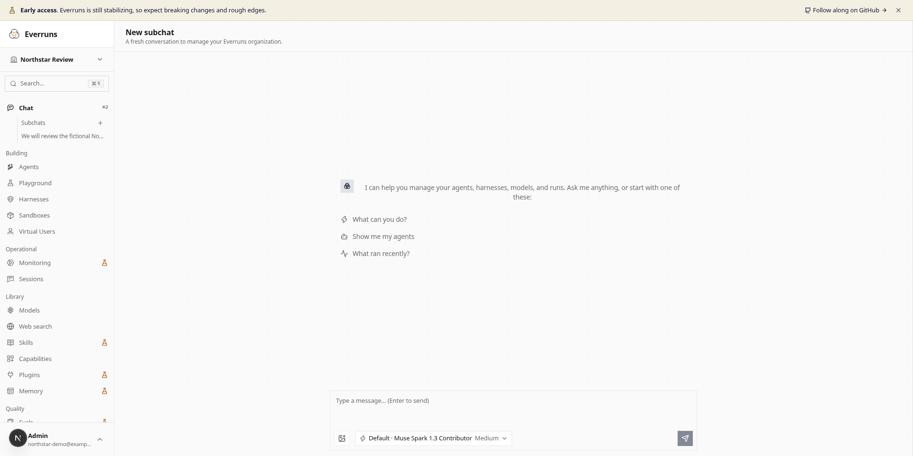
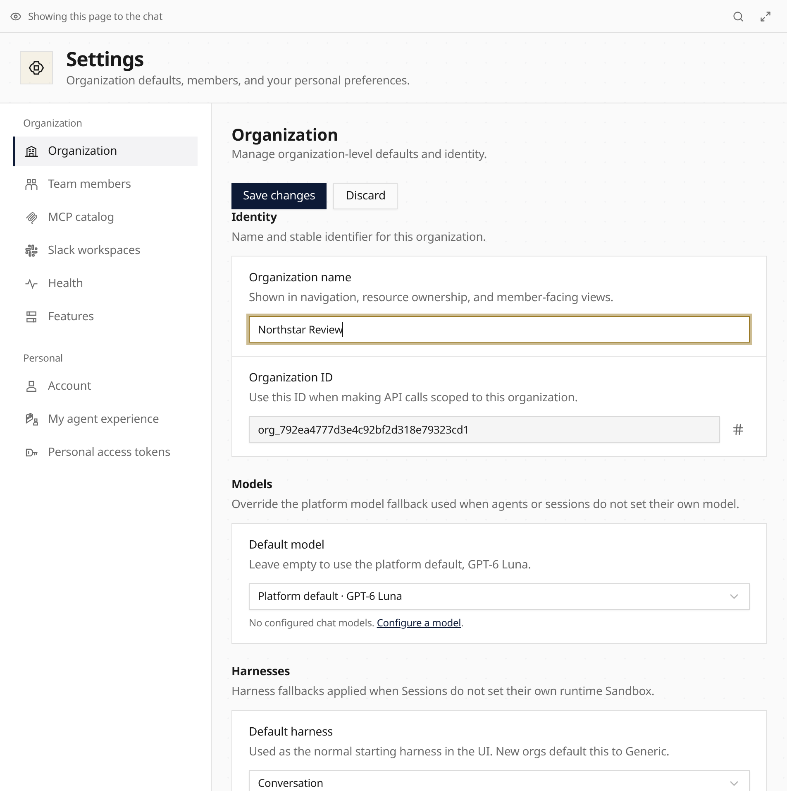
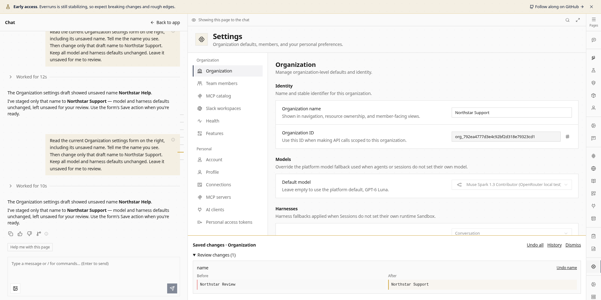

Enable **Chat workspace** in Adoption to work beside app pages. Chat reads supported
live forms, stages edits, and leaves **Save** or **Create** to you. Credentials and
approvals keep their manual controls.

Existing-resource editors share **Before/After**, field-level **Undo**, **Undo all**
and **History**. Save and Undo reject stale revisions. Reviews survive navigation;
model selections apply and undo atomically. Private profile history stays owner-only.

Connected-account names, Sandbox Template labels, and your organization profile
share the guarded review flow through REST and Chat.

**New subchat** starts an independent conversation on the same assistant. Selecting
it replaces the conversation. Full Chat shows one conversation; Command/Ctrl-J
opens page-side Chat from an app page. Core Chat and subchats need no feature flag.
**Chat background work** separately enables delegation and its Work panel.

See [Platform Chat](/built-ins/harnesses/platform-chat/).

