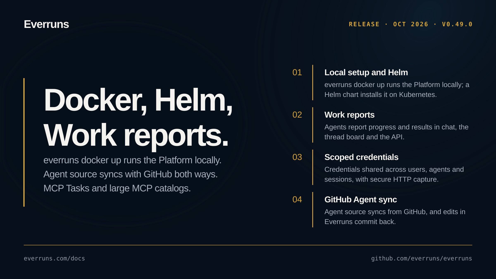

## Highlights

- **Local setup and Helm chart**: `everruns docker up` runs the self-hosted Platform on your machine with Docker in one command and asks how people sign in; `upgrade`, `reset`, `status`, `logs` and `doctor` manage it. A Helm chart published to `oci://ghcr.io/everruns/charts/everruns` installs the Platform on Kubernetes ([changelog](/changelog/2026-10-25-everruns-docker-up/), [Helm changelog](/changelog/2026-10-25-helm-chart/), [#4895](https://github.com/everruns/everruns/pull/4895), [#4904](https://github.com/everruns/everruns/pull/4904), [#4906](https://github.com/everruns/everruns/pull/4906), [#4910](https://github.com/everruns/everruns/pull/4910)).
- **Work reports**: Agents report what they are doing and what came out of it; reports show in chat, the thread board and the sessions list, and `GET /v1/sessions/{id}/work` returns them ([changelog](/changelog/2026-10-24-work-reports/), [#4885](https://github.com/everruns/everruns/pull/4885), [#4890](https://github.com/everruns/everruns/pull/4890), [#4891](https://github.com/everruns/everruns/pull/4891), [#4892](https://github.com/everruns/everruns/pull/4892)).
- **Scoped credentials**: Credentials can be shared across users, agents and sessions with scoped access, and HTTP capture stores secrets without showing them to the agent ([changelog](/changelog/2026-10-19-scoped-credentials-secure-capture/), [#4828](https://github.com/everruns/everruns/pull/4828)).
- **Agent source synced with GitHub**: An Agent's source syncs continuously from a GitHub repository, and in two-way mode edits made in Everruns are committed back to the branch ([changelog](/changelog/2026-10-25-two-way-agent-github-sync/), [#4869](https://github.com/everruns/everruns/pull/4869), [#4919](https://github.com/everruns/everruns/pull/4919)).

## Upgrade notes

- Session secrets are write-only to agents: `secret_store` sets, lists and deletes, but `get` no longer returns a value ([#4676](https://github.com/everruns/everruns/pull/4676)).
- Development mode (`DEV_MODE=true`) refuses to run as root; run it as a regular user or use external PostgreSQL ([#4722](https://github.com/everruns/everruns/pull/4722)).
- The experimental Deno Deploy sandbox provider and its `deno_*` tools are removed; use Daytona, E2B, Sprites, Modal or the container sandbox ([#4769](https://github.com/everruns/everruns/pull/4769)).

## In the changelog

- [Agents can no longer read secrets back](/changelog/2026-10-13-agents-cannot-read-secrets/)
- [Answers cut off by a provider error are retried](/changelog/2026-10-13-answers-cut-off-are-retried/)
- [Stored attachments download safely in browsers](/changelog/2026-10-13-attachments-download-safely/)
- [Attachments stay readable after compaction, from every channel](/changelog/2026-10-13-attachments-survive-compaction/)
- [Dev mode PostgreSQL requires a non-root user](/changelog/2026-10-13-dev-mode-postgres-user/)
- [E2B desktop computer use keeps the pointer where it was moved](/changelog/2026-10-13-e2b-desktop-pointer-reset/)
- [Gemini 4 Argon continues long responses across requests](/changelog/2026-10-13-gemini-argon-long-decode/)
- [MCP resource reads enforce conversation attachments](/changelog/2026-10-13-mcp-resource-attachment-scope/)
- [Remote workers run turns without an encryption key on the API](/changelog/2026-10-13-remote-workers-without-encryption-key/)
- [Tool calls cut off by a crash are rerun when it is safe](/changelog/2026-10-13-tool-calls-survive-crashes/)
- [Schedule triggers read cron weekdays from Sunday as 0](/changelog/2026-10-13-trigger-cron-weekdays-from-sunday/)
- [Visti and Stend join the product footer](/changelog/2026-10-13-visti-stend-footer-links/)
- [Monitor agent execution and actor leases at fleet scale](/changelog/2026-10-14-agent-execution-monitoring/)
- [Concurrent session creation reuses one runtime account](/changelog/2026-10-14-concurrent-session-account-creation/)
- [Framework and serve keep files in the session](/changelog/2026-10-14-framework-serve-attachments/)
- [Gemini setups prefer Argon and include it in favourites](/changelog/2026-10-14-gemini-argon-default/)
- [More reliable Framework agent sessions](/changelog/2026-10-14-local-session-reliability/)
- [Local stress tests use successful offline tool workloads](/changelog/2026-10-14-local-stress-testing/)
- [OpenTelemetry fixes export and cached-token totals](/changelog/2026-10-14-opentelemetry-export-and-accounting/)
- [PACT delegated turns discover the user's MCP tools](/changelog/2026-10-14-pact-delegated-mcp-tools/)
- [Recurring schedules reject unverified cron intervals](/changelog/2026-10-14-session-cron-interval-validation/)
- [A Slack integration overview for building Agents](/changelog/2026-10-14-slack-integration-overview/)
- [Tool events expose scoped worker CPU observations](/changelog/2026-10-14-tool-worker-cpu-observations/)
- [React session streams can suspend while idle](/changelog/2026-10-15-optional-idle-session-streams/)
- [Find failed agent turns from the Agents list](/changelog/2026-10-16-agent-failure-investigation/)
- [Agent session lists now match their session count](/changelog/2026-10-16-agent-session-history/)
- [Connect your coding agent from the Everruns UI](/changelog/2026-10-16-coding-agent-onboarding/)
- [Everruns shares product and workflow skills](/changelog/2026-10-16-platform-operating-skills/)
- [Deno Deploy sandbox integration removed](/changelog/2026-10-16-remove-deno-deploy/)
- [Slack workspace consent stays with its initiating browser](/changelog/2026-10-16-slack-workspace-browser-binding/)
- [User MCP management respects approval settings](/changelog/2026-10-16-user-mcp-approval-policy/)
- [Run Everruns provider drivers with WASM host fetch](/changelog/2026-10-16-wasm-provider-host-fetch/)
- [Automatic session titles with a shared small model](/changelog/2026-10-17-automatic-session-titles/)
- [ChatGPT Plan removed from Platform setup](/changelog/2026-10-17-chatgpt-plan-ui-removal/)
- [Framework hosts can brand ChatGPT login completion](/changelog/2026-10-17-custom-chatgpt-login-pages/)
- [OAuth MCP servers with path-specific metadata now connect](/changelog/2026-10-17-mcp-oauth-discovery-fallbacks/)
- [Connecting GitHub as yourself acts as you, not the shared bot](/changelog/2026-10-18-github-person-sign-in/)
- [MCP client authorization follows callback redirects](/changelog/2026-10-18-mcp-client-authorization-redirects/)
- [Turns no longer fail when a provider asks to wait too long](/changelog/2026-10-18-provider-retry-after-budget/)
- [Schedule triggers can run in a Slack conversation](/changelog/2026-10-18-schedule-triggers-in-slack-conversations/)
- [Sessions no longer hang when a worker stalls before a turn](/changelog/2026-10-18-stalled-worker-sessions-recover/)
- [Tenant egress proxy for self-hosted deployments](/changelog/2026-10-18-tenant-egress-proxy/)
- [Bring host capabilities and providers into Engine sessions](/changelog/2026-10-19-engine-host-services/)
- [Run commands and hot-install capabilities on live sessions](/changelog/2026-10-19-engine-session-controls/)
- [Gemini citations survive every continuation hop](/changelog/2026-10-19-gemini-continuation-grounding/)
- [Harness capabilities keep their name and details](/changelog/2026-10-19-harness-capability-metadata/)
- [Credentials work across users, agents and sessions](/changelog/2026-10-19-scoped-credentials-secure-capture/)
- [Send host-written review completions on Framework sessions](/changelog/2026-10-19-session-curated-completions/)
- [Large MCP catalogs use bounded search and schemas](/changelog/2026-10-21-large-mcp-catalogs/)
- [Chat mode keeps Agent edits beside the conversation](/changelog/2026-10-23-chat-beside-agent-pages/)
- [Agents wait on MCP servers that run tools as tasks](/changelog/2026-10-23-mcp-tasks-client/)
- [MCP Tasks run one agent turn per task](/changelog/2026-10-23-mcp-tasks-per-turn/)
- [MCP tool calls can run longer than 60 seconds](/changelog/2026-10-23-mcp-tool-timeout/)
- [Sync Agent source continuously from GitHub](/changelog/2026-10-23-sync-agent-source-github/)
- [Knowledge unifies files and optional indexed search](/changelog/2026-10-23-unified-knowledge-files/)
- [Agent actions and searchable Playground setup](/changelog/2026-10-24-agent-actions-playground-search/)
- [Publish a dedicated Work Chat for an Agent](/changelog/2026-10-24-hosted-work-chat/)
- [Work reports show what an agent is doing and got done](/changelog/2026-10-24-work-reports/)
- [Limit outbound network for Daytona and E2B sandboxes](/changelog/2026-10-25-daytona-network-rules/)
- [Run Everruns on your machine with one command](/changelog/2026-10-25-everruns-docker-up/)
- [Install the self-hosted Platform on Kubernetes with Helm](/changelog/2026-10-25-helm-chart/)
- [Live event delivery recovers after a NATS restart](/changelog/2026-10-25-nats-stream-recovery/)
- [Give a Daytona or E2B sandbox a desktop](/changelog/2026-10-25-sandbox-desktop/)
- [Sandboxes are disposable, their records are kept](/changelog/2026-10-25-sandbox-retention/)
- [Edit GitHub-synced Agents from either side](/changelog/2026-10-25-two-way-agent-github-sync/)

See the [GitHub release](https://github.com/everruns/everruns/releases/tag/v0.49.0) and the [full release notes](https://github.com/everruns/everruns/blob/main/CHANGELOG.md#0490---2026-10-26) for every pull request in this version.
