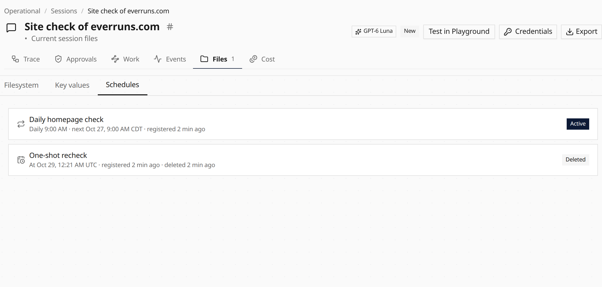

The session page now shows the filesystem, key values, and schedules for a run.
That includes a sandbox session, which keeps its files and desktop recordings
on the session filesystem and its values in session storage, but did not open
the Files tab before. Open **Files** and switch between **Filesystem**, **Key
values**, and **Schedules**.

Key values are listed on their own. A deleted schedule stays on the session as
**Deleted**, with when it was registered and when it was removed. It does not
fire again, and the agent's `list_schedules` tool no longer returns it.
Canceling a schedule still only disables it.



```json
{
  "description": "Recheck the homepage",
  "enabled": false,
  "deleted_at": "2026-10-26T23:00:00Z"
}
```

See [File System](/capabilities/file-system/), [Storage](/capabilities/session-storage/), and [Schedules](/capabilities/session-schedules/).
