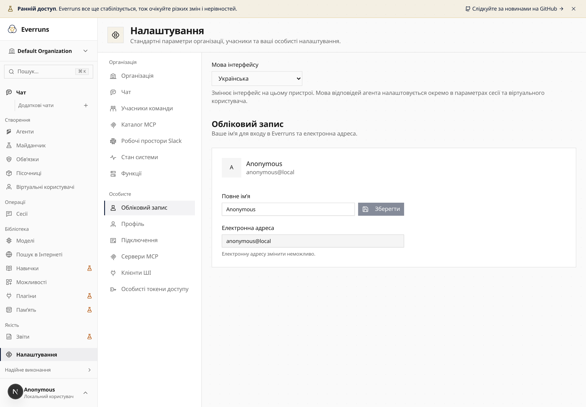
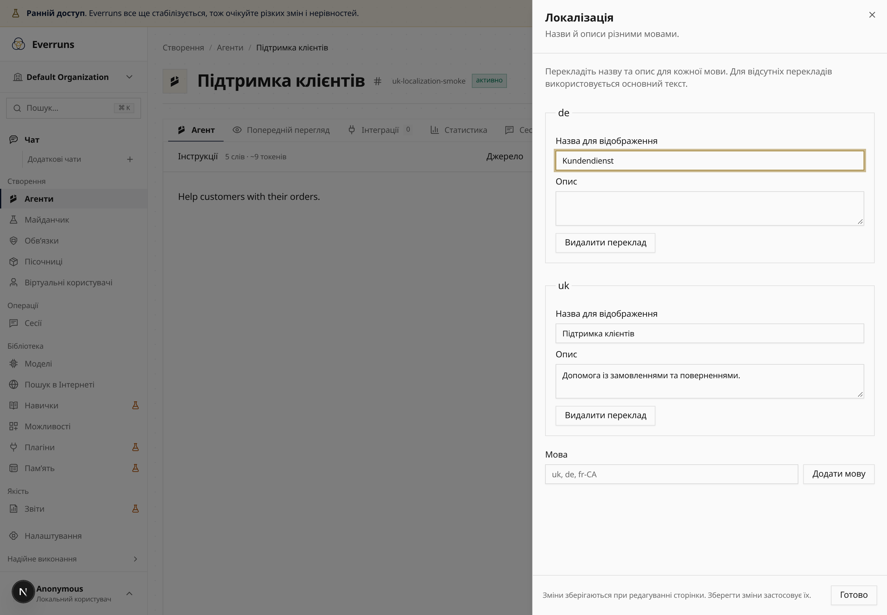

Choose **Українська** under **Settings → Account → Interface language** for
Ukrainian navigation, editors, messages and counters. The choice persists on your
device. Agent response language has its own session and virtual-user settings.

Agents and harnesses have a **Localization** section for translated display names
and descriptions in any locale. Save translations with the other page edits.
They appear in lists, search, selectors and detail pages.

[Agent files](/reference/agent-package/#localized-display-names) preserve translations
through Markdown, TOML, YAML, JSON, folders and ZIP archives:

```toml
schema_version = 1
name = "support"
instructions = "Help customers."

[localizations.uk]
display_name = "Підтримка"
```




