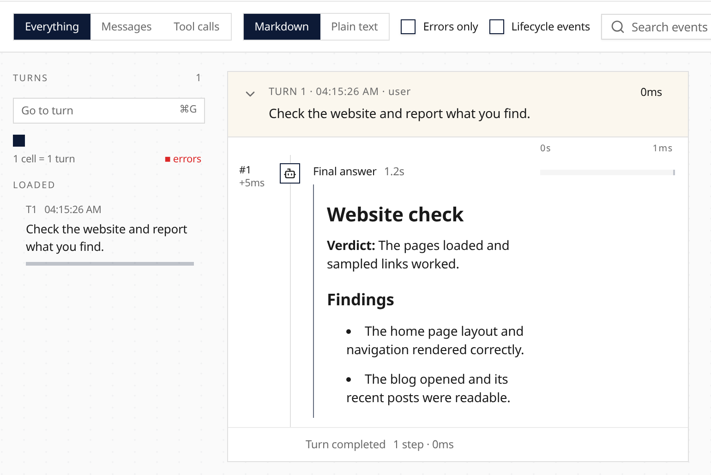

Session trace model messages and answers now render Markdown by default, making headings, lists, links, and code easier to read. Choose **Plain text** in the trace controls to inspect the original message source; choose **Markdown** to return to the formatted view.

The choice applies to the loaded trace, including expanded sub-agent steps, and stays in the page URL so it can be shared. Learn more about the [Web UI](/features/ui/).
