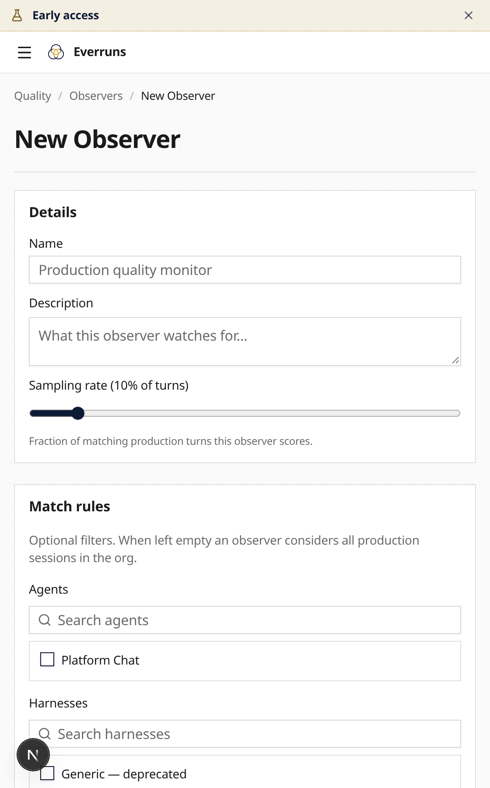

Model, agent and harness pickers now share searchable selection, including account names,
harness descriptions and unavailable saved values. Observer forms use searchable resource
bindings, tag chips and a styled sampling slider. Reports and provider pages use the shared
page layout, and mobile Settings replaces its full navigation list with a destination selector.

Destructive actions use application confirmation dialogs. Leaving the page or switching
organizations cancels unanswered confirmations. Shared pagination, pending buttons and form
feedback follow the same [Slate component rules](/design-system/components/).

