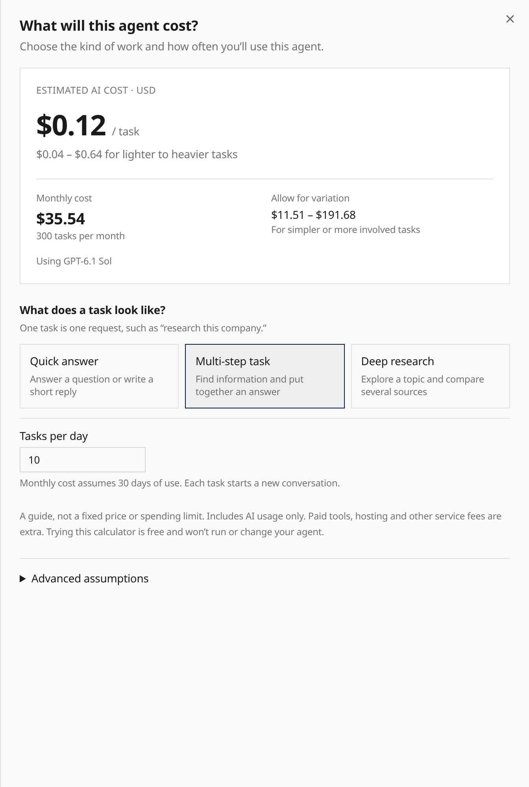

The [Agent page](/features/ui/#estimate-agent-cost) now has **Estimate cost** in
the page header. Choose the kind of task and enter tasks per day to see the estimated
cost per task and per month. Optional **Advanced assumptions** contains token controls
and the detailed breakdown.

Estimates use the current draft's assembled instructions and tools, inherited model
selection and catalog prices. They account for growing conversation context,
long-context pricing and output limits. Missing prices remain unavailable.

The lighter-to-heavier range is a planning scenario, not a quote or spending limit.
Sandbox, paid-tool and platform fees are excluded. Opening the estimator does not
run or save the agent.
