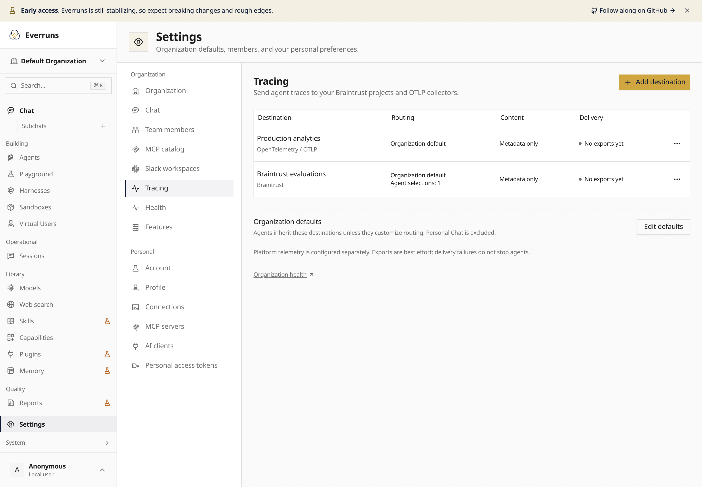
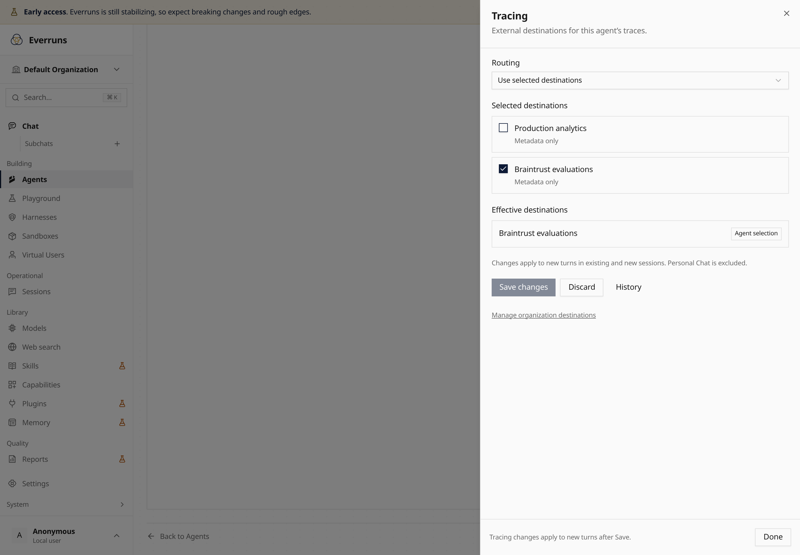

Connect multiple Braintrust projects and OpenTelemetry collectors in
**Settings → Organization → Tracing**. New destinations start unassigned and
export metadata only. Credentials stay encrypted; messages, tool content, and
reasoning require explicit opt-in.

Choose organization defaults, then use an agent's **More → Tracing** drawer to
inherit, add destinations, replace defaults, or turn customer exports off.
Routing changes apply to new turns. Personal Chat stays excluded, and existing
platform telemetry continues independently. Send a synthetic test trace and
inspect delivery status without running an agent.

Stop one agent's customer exports from the CLI:

```sh
everruns tracing routing update --id agent_01933b5a000070008000000000000001 \
  --mode off --destination-ids '[]' --reason 'Disable external exports'
```





Read the [setup and delivery guide](/observability/destinations/).
