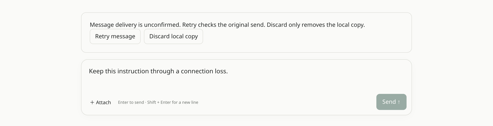

Chat restores unsent text and unacknowledged messages in the same browser
tab. Restored messages offer **Retry** and **Discard**. Retry preserves the
original send. Discarding a local copy does not cancel accepted work.
Storage failures leave text editable.

[Platform Chat](/built-ins/harnesses/platform-chat/) shares live session
subscriptions with task views and reconnects after network return. Hosted
Work Chat also preserves uncertain sends across reloads and stops stream
retries when access is rejected. Its retries use the
[Agent API's idempotency contract](/features/agent-api/).

Recovery stays scoped to the account or browser login and conversation.
Logout clears it. Closing the tab or clearing site data can remove local
recovery; this does not provide an offline model or application shell.

## Update 2026-10-29

Hosted Work Chat streams stay open past 30 seconds. Connection timeouts cover
setup; leaving the conversation closes the stream.

## Update 2026-10-30

Worker recovery reuses the saved answer and preserves its reference and work
counters.
