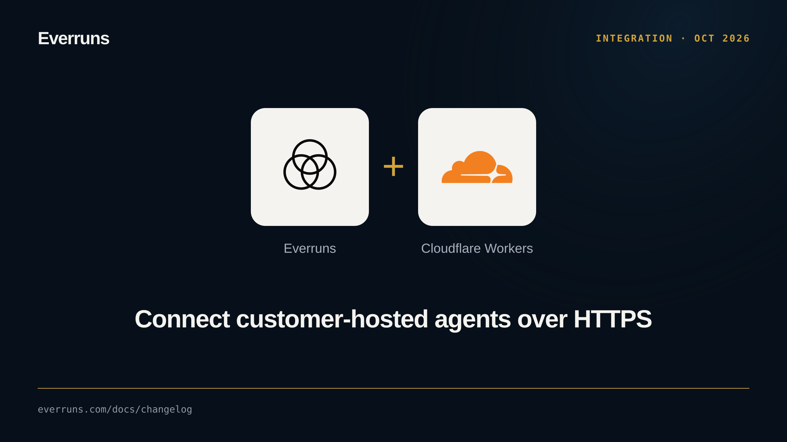
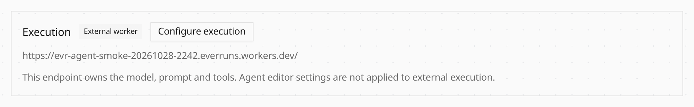

Connect an agent running in your own infrastructure through **Configure execution**
on its ordinary Agent page. Verify an HTTPS endpoint with a shared secret, then
use the same Playground, sessions and Trace views. Disabling the endpoint keeps
queued work bound to it.

The [Cloudflare Agent guide](/how-to/cloudflare-agent/) includes a complete
JavaScript agent with a real model, a private D1 database tool, registration and
normal API invocation. Slack channels use Direct communication for basic replies.
The endpoint supplies model and tool instrumentation; native approvals,
delegation and Explicit communication are outside this example.

Self-hosted installations enable `EXTERNAL_AGENTS_ENABLED=true`. Cloud availability
requires the corresponding hosted deployment.
