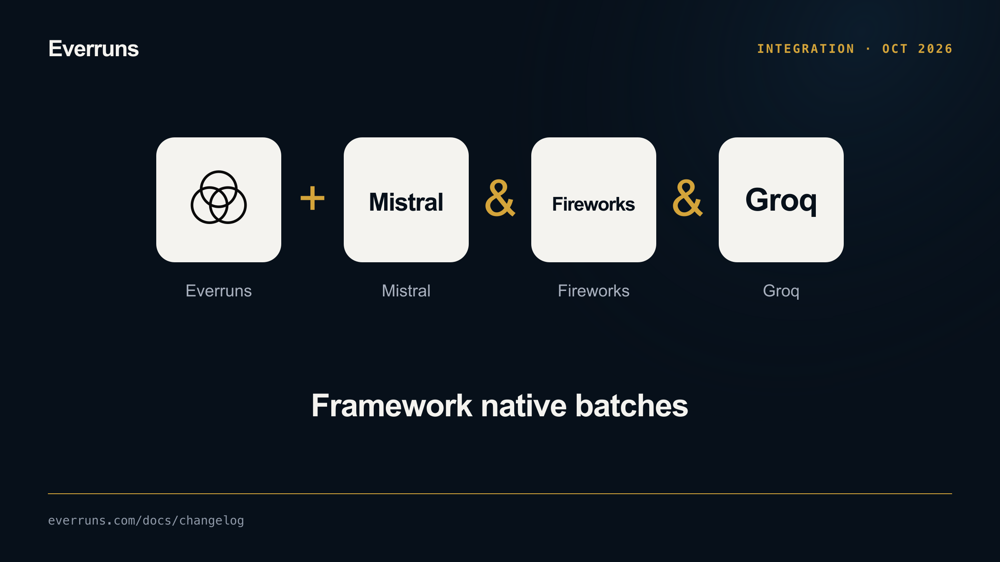

Framework batches now support Mistral inline jobs, Fireworks dataset jobs and
Groq Files/Batches through the same optional driver capability. The new
[Groq provider](/providers/groq/) also supports interactive Chat Completions.
Enable `groq` for this example; use the Git dependency in
[Batch Model Requests](/framework/batch-model-requests/) until published:

```rust
use everruns::{Model, batch::Batch, providers::groq::Groq};

# async fn example() -> Result<(), Box<dyn std::error::Error>> {
let ticket = Batch::new(Groq::from_env()?, "reviews/groq-account")
    .request("review_001", Model::from("llama-3.1-8b-instant").completion()
        .user("Classify: delivery arrived early.").max_tokens(64))?
    .submit().await?;
let saved = serde_json::to_vec(&ticket)?;
# let _ = saved;
# Ok(())
# }
```

Persist the ticket and reconstruct the same scoped provider to collect later.
Fireworks requires explicit account and trusted artifact-origin configuration;
its cancellation operation is unsupported and never deletes a job. Examples
cover submission, resumption, collection and cancellation where supported.
