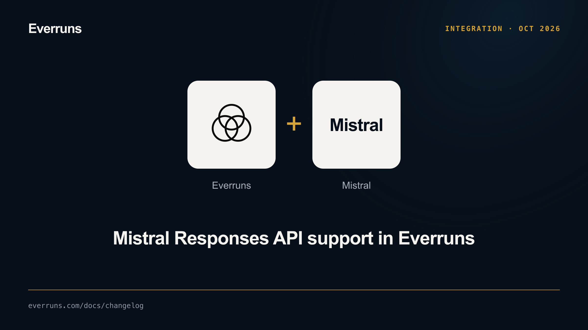

The [Mistral provider](/providers/mistral/) now supports
Mistral's Responses API preview. Framework callers select the protocol on the provider connection:

```rust
use everruns::{Mistral, MistralApi};

let provider = Mistral::from_env()?.api(MistralApi::Responses);
```

The integration streams text, reasoning and function calls, replays full
conversation history, and accepts images and files in user messages and tool
results. JSON Schema output, token usage and prompt-cache routing use the same
call configuration. Chat Completions remains the default.

Responses is stateless: Everruns sends `store: false` and does not chain response
IDs. Non-streaming calls collect the stream; incomplete or interrupted responses
fail the call. The provider guide lists the preview's configuration and limits.

OpenAI uses the same `.api(...)` pattern with `OpenAIApi`. Every production
provider now has a typed Framework configuration, with its authentication
requirements kept explicit. Hosted provider create/update requests accept `api`,
validate it against the driver catalog, and persist it for direct and remote
workers. Shared per-call settings remain provider-neutral.
