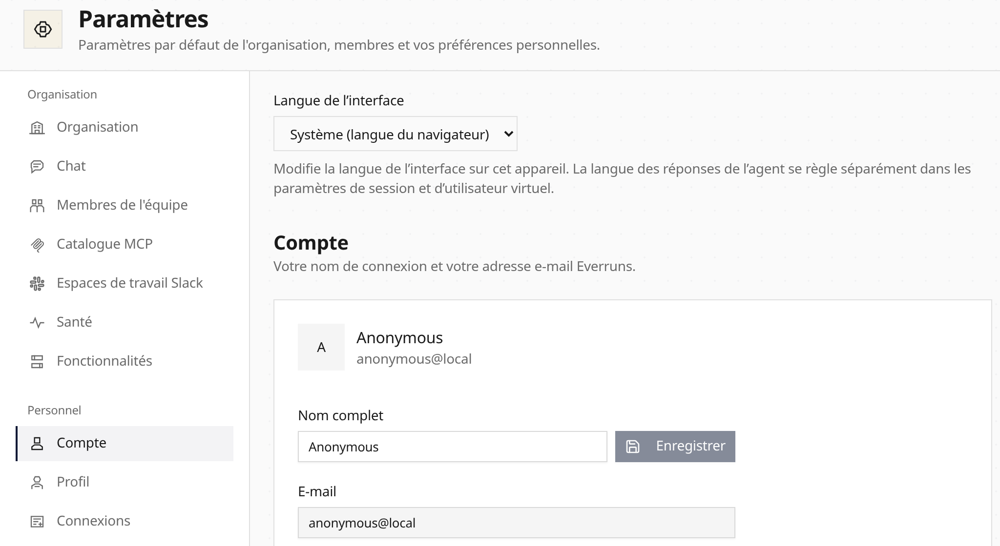

Choose **Français**, **Deutsch**, **Español**, **中文（简体）** or
**English (United Kingdom)** in **Settings → Profile → Interface language**.
**System** follows your supported browser preferences. British English uses UK
spelling and date ordering; financial amounts keep their original currency.

Built-in capability labels and harness names follow the interface language.
Platform messages support the same language families through the execution
locale. Agent response language remains a separate setting.

[Agent files](/reference/agent-package/#localized-display-names) retain generic
locale-keyed names and descriptions in every supported format:

```toml
[localizations.fr]
display_name = "Assistance"

[localizations.zh-CN]
display_name = "客户支持"

[localizations.en-GB]
display_name = "Customer support"
```


