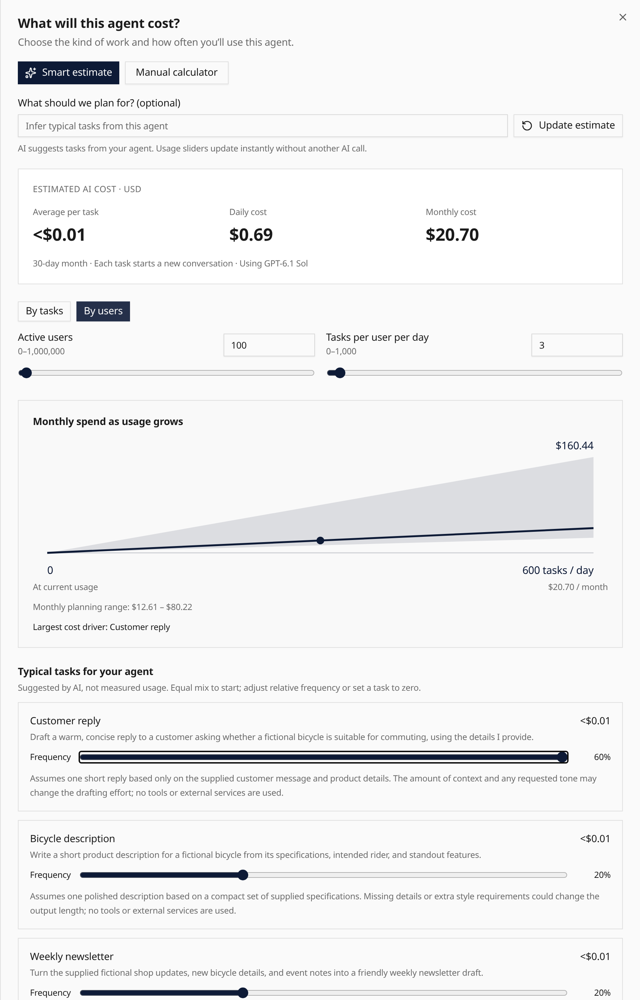
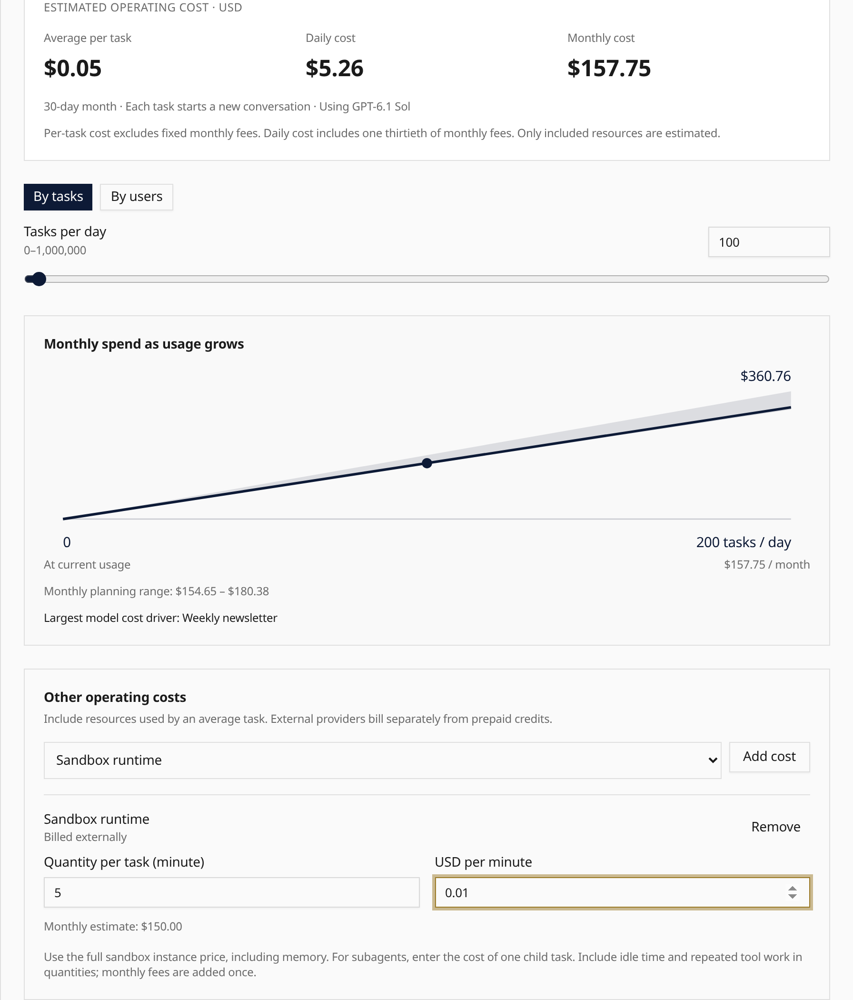

**Estimate cost** suggests typical tasks from your agent’s instructions and tools. Adjust the
task mix, then choose tasks per day or active users to explore daily and monthly costs.
The utility model proposes workloads; catalog prices determine model costs.

**Other operating costs** adds sandbox runtime, paid tools, media, subagent work and monthly
fees using your quantities and provider prices. Missing prices are flagged. **Advanced
assumptions** includes cache usage and a model retry allowance. Monthly fees and stored capacity count once,
even at zero task volume.

These are planning scenarios for included resources, not measured usage or spending limits.
The manual calculator remains available when smart estimates are unavailable. No tasks run
and the agent is not changed.

Open an agent and select [Estimate cost](/features/ui/#estimate-agent-cost).
