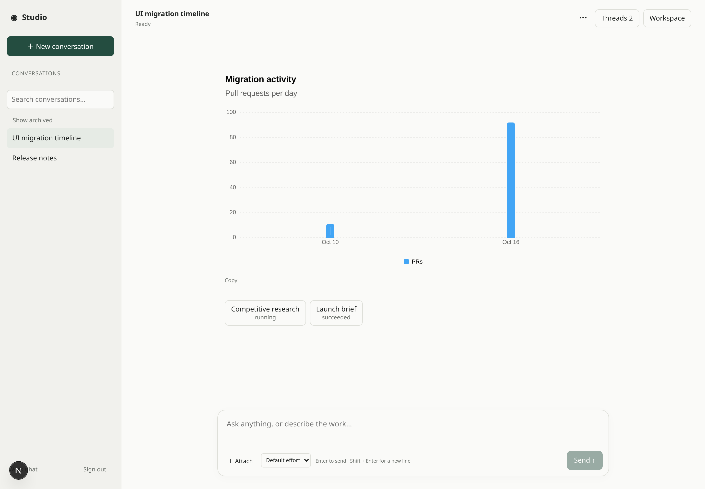

[Work Chat channels](/features/channels/#work-chat) now render OpenUI charts and
A2UI widgets alongside Markdown, with work logs attached to each reply and task
cards linking to background conversations.

Attach multiple files, preview Markdown, images, searchable CSV and sandboxed
HTML, or download results. Conversation actions support search, rename, pin and
archive/reopen. Publishers choose which models consumers may select.

Share a conversation through a revocable read-only link. Public viewers see
messages and widgets; workspace files and execution controls stay private.

## Update 2026-10-28

Console chat and Work Chat now share the full 69-component A2UI 1.0 catalog,
including bindings and surface updates. See [shared generative UI](/changelog/2026-10-28-shared-generative-ui/).
