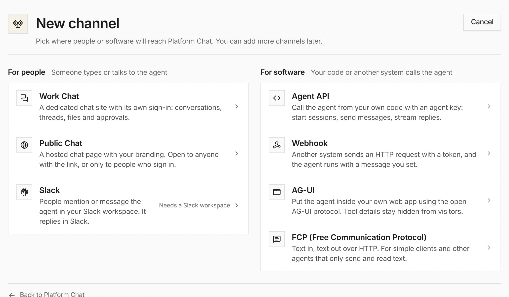

**Add channel** now asks who will use the channel. Types are grouped under
**For people** and **For software**, each with one plain sentence and what it
needs first, such as a Slack workspace. The form after it is split into named
sections, and rarely changed limits fold behind a summary.

On the agent's **Integrations** tab, channels are rows showing status and when
each was last used. A row opens the channel's page: **Connect** shows the link,
request URL or code to use it, and **Settings** edits it with Save changes and
Discard. See [Channels](/features/channels/).

