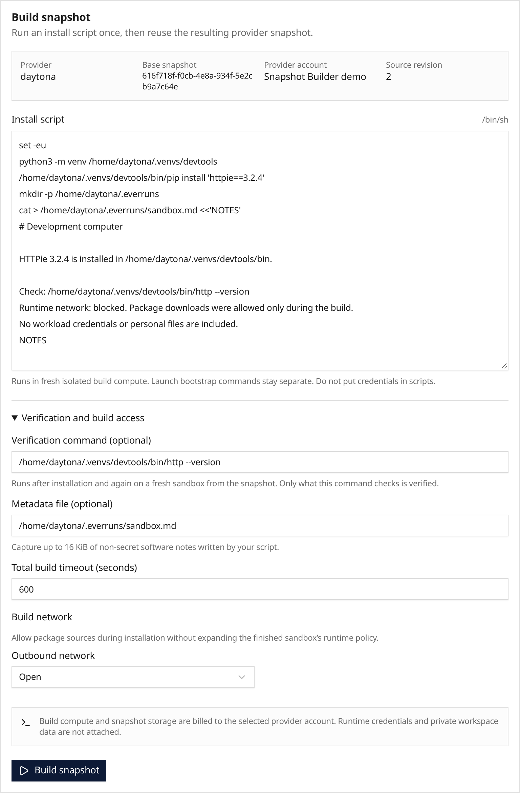

**In the UI:** Open an editable Daytona [Sandbox Template](/features/sandbox-templates/#build-a-reusable-snapshot),
select a named Organization account, and choose **Build snapshot**. Supply an install script,
optional verification command and software-notes file. Build network access stays separate
from runtime policy. Everruns checks a fresh launch and cleans up disposable compute before
**Save new revision** becomes available. Existing Agent and Session pins stay unchanged.

**In code:** The same lifecycle is available through the API and `everruns sandbox-templates builds`.
Cancel running attempts or discard unused snapshots. Applied artifacts remain retained for older
pins. Provider credentials stay outside build compute; scripts receive no workload credentials or
private Session workspace. Daytona is the first snapshot-build adapter; ordinary templates for
other targets remain configurable.

## Walkthrough

Watch a real Daytona build, from script to verified snapshot and saved revision.
The 52-second cut shortens installation and provider waits; Sarah narration is synthesized.

<video controls playsinline preload="none" width="1920" height="1080" style="width:100%;height:auto;aspect-ratio:16/9" poster="./walkthrough-poster@2x.png" src="./walkthrough.mp4" aria-label="Build reusable sandbox snapshots in Everruns">
  <track kind="captions" src="/videos/sandbox-builder.en.vtt" srclang="en" label="English" default>
</video>

[Read the English captions](/videos/sandbox-builder.en.vtt).
