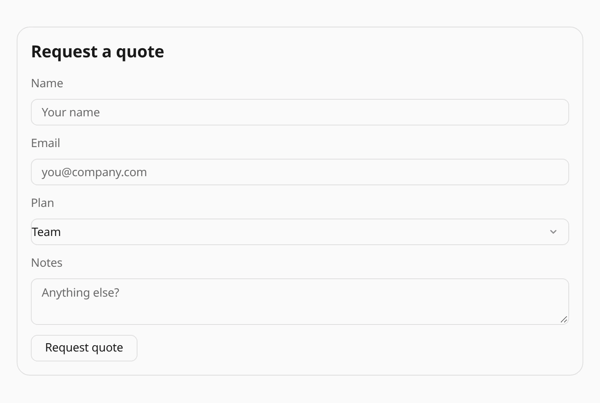

Console chat and Work Chat now share the 69-component A2UI 1.0 standard catalog.
Forms, charts, tables, tabs, media and cards use one renderer, with matching
bindings, validation and message actions. Saved nested A2UI trees and OpenUI
replies continue to render.

Enable the **A2UI** capability and ask:

```text
Show a quote request form with name, email, plan and notes.
```

Form submissions use the conversation's existing message and approval path.
Busy and read-only views disable message actions. HTML widgets remain sandboxed
without scripts or external network access. See [Generative UI in chat](/features/generative-ui/)
for the supported format and interaction limits.

Explore the [component gallery](/reference/generative-ui/) for interactive examples
in both themes and the A2UI source for each example. See [AG-UI support](/integrations/ag-ui/)
for the event protocol and chat integration boundaries.



**Update 2026-10-29:** Browse eight focused pages under **Reference → Generative UI**.
Live controls show action results locally and include Reset; no account or agent
run is needed.
