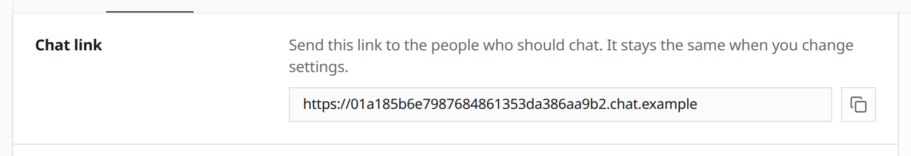

A published **Work Chat** channel page shows the chat's address once, above
the settings. There is no separate Connect tab. Open it with **Open chat
page** in the header, including while you are editing. The address stays the
same when you change settings. It appears after you publish, on a deployment
that has a hosted chat domain.

See [Work Chat](/features/channels/#work-chat).

