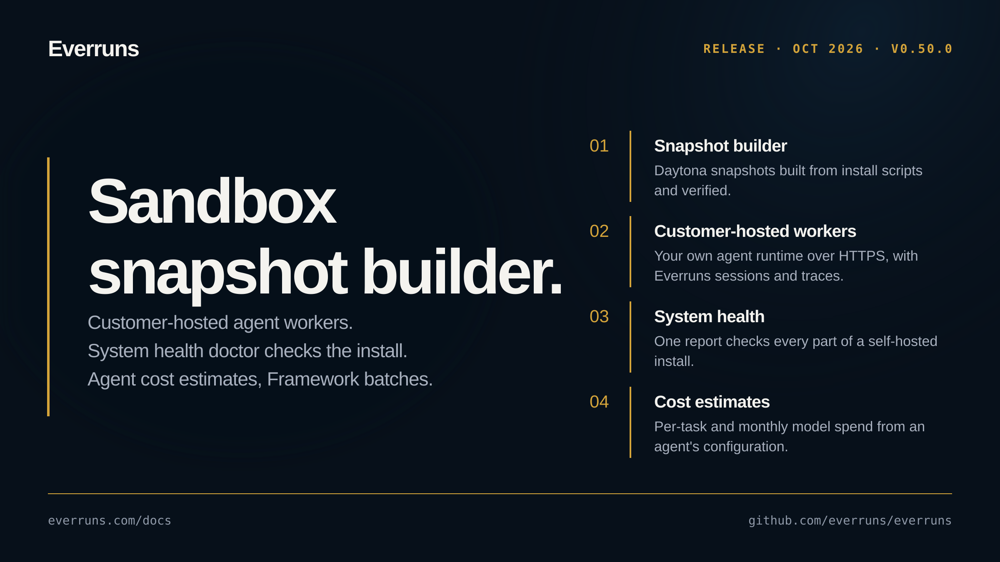

## Highlights

- **Sandbox snapshot builder**: Build Daytona snapshots from install scripts, verify them in fresh compute, and save them as Sandbox Template revisions ([changelog](/changelog/2026-10-29-sandbox-snapshot-builder/), [#5040](https://github.com/everruns/everruns/pull/5040)).
- **Customer-hosted agent workers**: Register your own agent runtime with an HTTPS endpoint, or connect agent-scoped custom workers with private tools, and keep Everruns sessions, tool traces, conversation history and Slack replies ([changelog](/changelog/2026-10-29-customer-hosted-agent-workers/), [custom workers changelog](/changelog/2026-10-27-custom-agent-workers/), [#5022](https://github.com/everruns/everruns/pull/5022), [#5057](https://github.com/everruns/everruns/pull/5057)).
- **System health doctor**: A System → Health page, `everruns-server --doctor` and doctor gauges check every part of a self-hosted install, from migrations and workers to sign-in keys, NATS, Valkey and file storage, and say how to fix what they find ([changelog](/changelog/2026-10-27-system-health-doctor/), [#4963](https://github.com/everruns/everruns/pull/4963), [#4971](https://github.com/everruns/everruns/pull/4971), [#4976](https://github.com/everruns/everruns/pull/4976)).
- **Agent cost estimates**: Plan per-task and monthly model spend from an agent's configuration, with suggested tasks, an adjustable task mix and live projections ([changelog](/changelog/2026-10-28-agent-cost-estimation/), [projections changelog](/changelog/2026-10-28-smart-agent-cost-projections/), [#5032](https://github.com/everruns/everruns/pull/5032), [#5050](https://github.com/everruns/everruns/pull/5050)).
- **Framework batch completions**: Submit independent completions as provider-native offline batches on Anthropic, OpenAI, Gemini, Mistral, Fireworks and Groq, and collect the results in another process ([changelog](/changelog/2026-10-27-framework-native-batch-requests/), [OpenAI and Gemini changelog](/changelog/2026-10-28-framework-openai-gemini-batches/), [Mistral, Fireworks and Groq changelog](/changelog/2026-10-28-framework-mistral-fireworks-groq-batches/), [#4978](https://github.com/everruns/everruns/pull/4978), [#5009](https://github.com/everruns/everruns/pull/5009), [#5027](https://github.com/everruns/everruns/pull/5027)).
- **Rolling deploys keep running work**: Servers drain connections and workers hand running turns to another worker on shutdown, and long tool calls no longer hold a worker slot ([changelog](/changelog/2026-10-29-graceful-rolling-deploys/), [long tool calls changelog](/changelog/2026-10-27-long-tool-calls-free-workers/), [#4954](https://github.com/everruns/everruns/pull/4954), [#5048](https://github.com/everruns/everruns/pull/5048)).
- **Interface languages**: The interface is available in Ukrainian, French, German, Spanish, Chinese and British English with regional formatting, and agents carry translated display names ([changelog](/changelog/2026-10-28-more-interface-languages/), [Ukrainian changelog](/changelog/2026-10-26-ukrainian-interface-agent-localization/), [#4961](https://github.com/everruns/everruns/pull/4961), [#4999](https://github.com/everruns/everruns/pull/4999)).
- **Agent tracing destinations**: Send traces to several Braintrust projects and OTLP collectors, with organization defaults and per-agent overrides ([changelog](/changelog/2026-10-28-agent-tracing-destinations/), [#4991](https://github.com/everruns/everruns/pull/4991)).

## Upgrade notes

- Conversation APIs return only reviewed message annotations. Applications that store their own annotations on messages write them under `metadata.custom`; other unknown keys stay stored but are no longer returned ([changelog](/changelog/2026-10-28-public-message-metadata/), [#5018](https://github.com/everruns/everruns/pull/5018)).
- Custom embedding drivers must set the new `response_id` field on `EmbedResponse` (`None` when the provider gives no ID) ([changelog](/changelog/2026-10-28-knowledge-embedding-attribution/), [#5041](https://github.com/everruns/everruns/pull/5041)).

## In the changelog

- [Raw event previews stay small for large tool results](/changelog/2026-10-26-bounded-event-previews/)
- [Review Chat changes across app pages](/changelog/2026-10-26-chat-page-settings/)
- [Watch what an agent did on its Sandbox desktop](/changelog/2026-10-26-desktop-recordings/)
- [Agents can discover approved MCP servers](/changelog/2026-10-26-discover-approved-mcp-servers/)
- [E2B sandbox traffic now follows your org's network rules](/changelog/2026-10-26-e2b-sandboxes-through-egress-proxy/)
- [Threat-intelligence deny feeds and abuse signals for outbound traffic](/changelog/2026-10-26-egress-deny-feeds/)
- [Choose a separate default model for Everruns Chat](/changelog/2026-10-26-independent-chat-model/)
- [Session files hold videos and other large media](/changelog/2026-10-26-large-session-files/)
- [Long sessions with many images no longer freeze](/changelog/2026-10-26-long-sessions-no-longer-freeze/)
- [See a session's files, values, and schedules](/changelog/2026-10-26-session-files-values-schedules/)
- [Ukrainian interface and localized agent names](/changelog/2026-10-26-ukrainian-interface-agent-localization/)
- [Bashkit recognizes empty workspace directories](/changelog/2026-10-27-bashkit-empty-workspace-directories/)
- [Browserless settings collapse into one toggle](/changelog/2026-10-27-browserless-single-toggle/)
- [Chats no longer hang waiting for a finished turn](/changelog/2026-10-27-chat-no-longer-waits-for-done/)
- [Connect custom agent workers to your control plane](/changelog/2026-10-27-custom-agent-workers/)
- [Submit Framework completions as offline batches](/changelog/2026-10-27-framework-native-batch-requests/)
- [Long tool calls no longer hold a worker slot](/changelog/2026-10-27-long-tool-calls-free-workers/)
- [A turn too large to resume is stopped instead of retried forever](/changelog/2026-10-27-oversized-turn-stops/)
- [Provider retries preserve the initiating user](/changelog/2026-10-27-provider-retry-user-context/)
- [Session trace messages render as Markdown](/changelog/2026-10-27-session-trace-markdown/)
- [Shared controls across resource pickers and forms](/changelog/2026-10-27-shared-ui-controls-layouts/)
- [System health doctor checks the whole install](/changelog/2026-10-27-system-health-doctor/)
- [Estimate agent model costs before running tasks](/changelog/2026-10-28-agent-cost-estimation/)
- [Route agent traces to your own destinations](/changelog/2026-10-28-agent-tracing-destinations/)
- [Chat restores drafts and uncertain message sends](/changelog/2026-10-28-chat-drafts-send-recovery/)
- [Agent background work sends fewer streaming updates](/changelog/2026-10-28-completion-only-agent-output/)
- [Submit Framework batches from message lists](/changelog/2026-10-28-framework-batch-message-lists/)
- [Framework batches add Mistral, Fireworks and Groq](/changelog/2026-10-28-framework-mistral-fireworks-groq-batches/)
- [Run Framework batches on OpenAI and Gemini](/changelog/2026-10-28-framework-openai-gemini-batches/)
- [Keep Knowledge embedding usage tied to its provider account](/changelog/2026-10-28-knowledge-embedding-attribution/)
- [French, German, Spanish, Chinese and British English](/changelog/2026-10-28-more-interface-languages/)
- [Several control-plane instances without NATS no longer split live chat](/changelog/2026-10-28-multi-server-live-events/)
- [Platform Chat uses native functions for platform operations](/changelog/2026-10-28-native-platform-functions/)
- [Complex OpenAI tool schemas use non-strict mode](/changelog/2026-10-28-openai-complex-tool-schemas/)
- [Conversation APIs return reviewed message metadata](/changelog/2026-10-28-public-message-metadata/)
- [Plan agent costs with AI task suggestions and projections](/changelog/2026-10-28-smart-agent-cost-projections/)
- [Long sessions avoid repeated message-history reads](/changelog/2026-10-28-targeted-session-message-lookups/)
- [Unfinished native web searches show failed status](/changelog/2026-10-28-unfinished-native-web-search/)
- [Work Chat renders interactive reports and artifacts](/changelog/2026-10-28-work-chat-rich-results/)
- [Worker turn requests now honor the configured TLS settings](/changelog/2026-10-28-worker-turn-tls/)
- [Clearer screens for adding and managing agent channels](/changelog/2026-10-29-clearer-channel-screens/)
- [Connect customer-hosted agents over HTTPS](/changelog/2026-10-29-customer-hosted-agent-workers/)
- [Rolling deploys no longer interrupt running agents](/changelog/2026-10-29-graceful-rolling-deploys/)
- [Build reusable sandboxes from install scripts](/changelog/2026-10-29-sandbox-snapshot-builder/)
- [Chat surfaces share 69 interactive UI components](/changelog/2026-10-29-shared-generative-ui/)
- [Work Chat channel pages link to the chat](/changelog/2026-10-29-work-chat-channel-link/)
- [Shell commands can rename workspace directories](/changelog/2026-10-29-workspace-directory-renames/)
- [Sessions with tool calls keep the prompt cache again](/changelog/2026-10-30-tool-results-keep-prompt-cache/)

See the [GitHub Release](https://github.com/everruns/everruns/releases/tag/v0.50.0) and the [0.50.0 section of CHANGELOG.md](https://github.com/everruns/everruns/blob/main/CHANGELOG.md#0500---2026-10-30).
