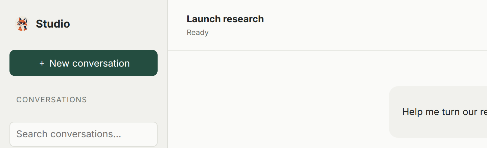

The Work Chat sidebar and an empty conversation now use the Agent's avatar.
The picture is the circle already set on the Agent. Set it in the console, and
Work Chat picks it up on the next load. An Agent with no avatar keeps the
round mark.

The picture is loaded from this chat host. The host returns only the avatar
currently set on this channel, and a picture that fails to load falls back
to the mark.

See [Work Chat](/features/channels/#work-chat).

