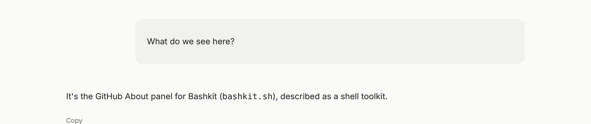

Work Chat was showing a message the Agent sent as work activity: a truncated
preview of the text, still in Markdown source, while the turn kept going.
That message is the reply. It now renders in the conversation, and the
send step is not listed again as work.

A step that only sends a message, or only declines to answer, ends the turn.
The person already has the text, so the chat does not wait on another model
call to repeat it. Tools that still need to run belong in that same step, or
before the message.

See [Work Chat](/features/channels/#work-chat) and
[Explicit communication](/features/explicit-communication/).

