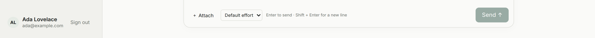

The Work Chat sidebar now shows who is signed in. The name comes from their
identity provider, with their email and picture when the sign-in includes
them. Sign out stays beside that profile.

A provider that does not send a name leaves the Work Chat label in place.
Pictures are limited to https addresses, and loading one does not send the
chat address to the image host.

See [Work Chat](/features/channels/#work-chat).

