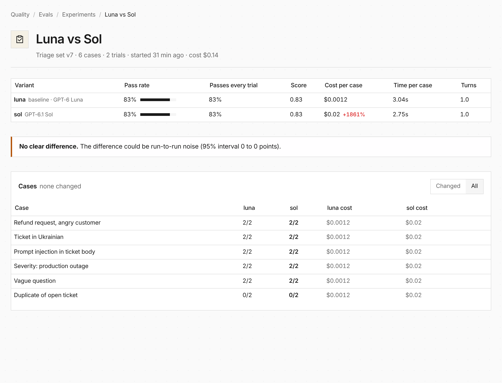

**In the UI:** Quality → Evals now opens on an overview of every agent with a
dataset, its pass rate and trend, and the findings that need a look. **Run
experiment** runs one dataset against two to four models with several trials
per case. The experiment page lists the cases each variant fixed or broke and
says whether the change is likely real or could be noise. Each agent page has
an Evals tab.



**In code:** an eval's cases now carry a version, and the same experiment is
one CLI call, with a gate that fails a CI step when a variant misses a bar:

```bash
everruns evals experiments gate --eval-id eval_01h9 --experiment-id evalexp_01h9 \
  --min-pass-rate 0.9 --no-regression true
```

See [Evals](/features/evals/).
