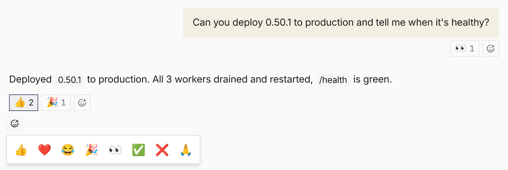

Anyone in a conversation can now put an emoji on a message, and so can the
agent. In Chat (see [Sessions](/features/ui/#sessions)) and Work Chat, reactions
show as chips under the message; the smile button opens a quick row of emoji.



A reaction on the agent's reply reaches the agent as a short note, not a typed
message, at its next turn. Add the **Reactions** capability to let the agent
react with `react` (👀 when it starts, ✅ when it is done) and to choose whether
a reaction starts a turn right away or is not told at all.

The [Agent API](/features/agent-api/) and `/v1` share the same routes:

```bash
curl -X PUT "$BASE/sessions/$SESSION/messages/$MESSAGE/reactions/%F0%9F%91%8D" \
  -H "Authorization: Bearer $KEY"
curl "$BASE/sessions/$SESSION/reactions" -H "Authorization: Bearer $KEY"
```
