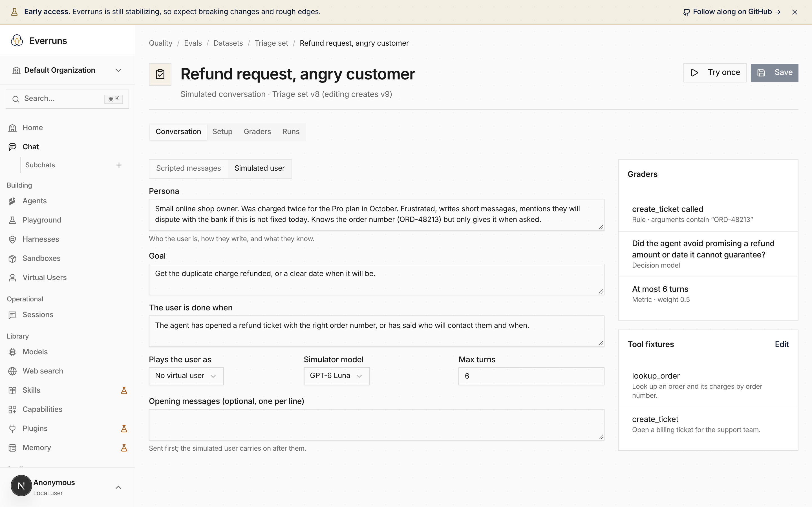

**In the UI:** each eval case has its own page. Switch a case from
**Scripted messages** to **Simulated user**, describe who the user is, what they
want and when they are done, and a model carries the conversation turn by turn
until the goal is met or the turn limit is reached. **Tool fixtures** give the
agent tools with canned responses, so a case can check that the agent opened
the right ticket without touching your helpdesk. **Try once** runs just that
case.



**In code:** the `tool_called` grader can now check a call's arguments, and a
run can be limited to selected cases:

```bash
everruns evals runs create --eval-id eval_01h9 --case-ids '["evalcase_01h9"]' \
  --reason 'Try the refund case once'
```

Client-side tools declared on a session (`tools` on create, and AG-UI frontend
tools) now reach the model when a worker runs the turn; before, a worker
dropped them.

See [Evals](/features/evals/).
